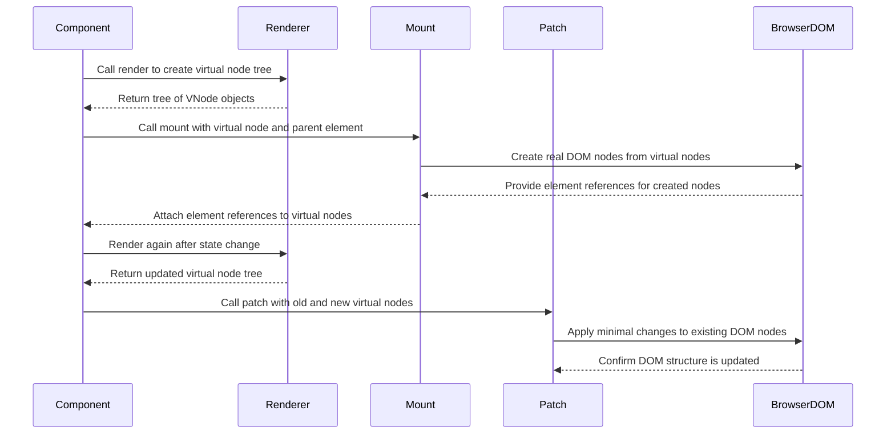

# Chapter 1: VNode / DOM_TYPES

Imagine you are building a UI library from scratch.

You call `document.createElement('div')`, wire some events, then a user clicks a button, state changes, and now half your elements need to move, some need to disappear, and others need to appear in the middle.

If you try to do this **directly on the DOM**, it quickly feels like trying to rebuild a house while people are still living in it. You must:

- Remember which element corresponds to which piece of data  
- Decide which elements to reuse vs. throw away  
- Avoid doing unnecessary DOM work so the page stays fast  

You need **a plan** before you touch real DOM nodes.

That plan is your **virtual DOM**. And the units in that plan are **virtual nodes** — VNodes — plus a small set of labels that say *what kind* of thing each node represents. Those labels are `DOM_TYPES`.

In this chapter, we’ll look at:

- What a VNode is, conceptually  
- How `DOM_TYPES` categorize every node in the tree  
- How other parts of the framework use VNodes and `DOM_TYPES` to mount, update, and remove things from the page  
- How your code will create VNodes using helper functions from the next chapter: [`h / hString / hFragment / hSlot`](02_h_hstring_hfragment_hslot.md)

---

## 1. The blueprint, not the building

Think of your UI as a house:

- The **actual DOM** is the *physical house*: bricks, windows, doors.  
- A **VNode** is a *blueprint*: what rooms should exist, how they connect, which furniture goes where.

You don’t start by moving bricks; you start by drawing a plan:

```js
// This is NOT DOM. It's just JS data describing DOM.
const view = {
  type: 'element',
  tag: 'button',
  props: { id: 'save-btn' },
  children: [
    { type: 'text', value: 'Save' },
  ],
}
```

That object is a **VNode**:

- It says: “There should be a `<button id="save-btn">Save</button>` here.”
- It doesn’t say *how* to create it.  
- It doesn’t hold a real DOM reference yet.  

Later, code like [`mountDOM`](04_mountdom_destroydom_patchdom.md) reads this object and actually does `document.createElement('button')`, sets `id`, appends a text node, and so on.

This separation gives us a huge advantage:

- We can compare the **old blueprint** and the **new blueprint** (VNodes)  
- Then we compute a minimal set of changes  
- Only then do we touch the real DOM

---

## 2. The `DOM_TYPES` catalog: naming the kinds of nodes

The framework needs to know **what kind** of VNode it’s dealing with at any moment:

- Text node?  
- Regular HTML element?  
- A component (user-defined, with state and lifecycle)?  
- A fragment (a wrapper for multiple children)?  
- A slot (placeholder for external content)?

To avoid guessing, we give every VNode a `type` from a small, fixed set: `DOM_TYPES`.

Here is the definition from `h.js`:

```js
export const DOM_TYPES = {
  TEXT: 'text',
  ELEMENT: 'element',
  FRAGMENT: 'fragment',
  COMPONENT: 'component',
  SLOT: 'slot',
}
```

This tiny object is used **everywhere** in the framework:

- [`mountDOM`](04_mountdom_destroydom_patchdom.md) uses it to decide *how* to build DOM from a VNode.  
- [`patchDOM`](04_mountdom_destroydom_patchdom.md) uses it to decide *how to compare* and update nodes.  
- [`destroyDOM`](04_mountdom_destroydom_patchdom.md) uses it to decide *how to unmount* nodes.  
- [`fillSlots`](06_slots_and_fillslots.md) uses it to *find slot placeholders*.

Think of `DOM_TYPES` like labels in a warehouse: **“Fragile”, “Perishable”, “Liquid”**. The label doesn’t store the object; it tells the system *how to treat* the object.

---

## 3. What exactly is a VNode?

In this framework, a VNode is always a plain JavaScript object with a `type` from `DOM_TYPES`. Depending on the type, different fields appear.

### 3.1 Text nodes (`DOM_TYPES.TEXT`)

**What it represents**

A text node in the DOM, like the “Hello” in:

```html
<p>Hello</p>
```

**Shape**

```js
// created by hString("Hello")
const textNode = {
  type: DOM_TYPES.TEXT,
  value: 'Hello',
  // el: Text node in the real DOM (added later by mountDOM)
}
```

- `type` — always `'text'`  
- `value` — the string content  
- `el` — reference to `document.createTextNode(...)` after mounting

Text nodes are leaf nodes: they don’t have `children`.

### 3.2 Element nodes (`DOM_TYPES.ELEMENT`)

**What it represents**

A regular HTML element:

```html
<button class="primary" disabled>Save</button>
```

**Shape**

```js
// created by h('button', { class: 'primary', disabled: true }, [hString('Save')])
const buttonNode = {
  type: DOM_TYPES.ELEMENT,
  tag: 'button',
  props: {
    class: 'primary',
    disabled: true,
    // plus special keys: on, style, etc.
  },
  children: [
    { type: DOM_TYPES.TEXT, value: 'Save' },
  ],
  // el: real <button> element in DOM (added later)
  // listeners: event listeners attached to this element (added later)
}
```

Key fields:

- `tag` — `'button'`, `'div'`, etc.  
- `props` — attributes, classes, styles, and special props like `on` for events  
- `children` — child VNodes (elements, text, components, fragments…)  
- `el` — reference to the real DOM element (set by `mountDOM`)  
- `listeners` — stored event listeners so they can be removed on unmount

### 3.3 Component nodes (`DOM_TYPES.COMPONENT`)

**What it represents**

A **component instance**, not a bare HTML tag. For example, something defined with [`defineComponent / Component`](03_definecomponent_component.md):

```js
import { defineComponent } from './component'

const Counter = defineComponent({
  state() {
    return { count: 0 }
  },
  render() {
    // ...
  },
})
```

When you create a VNode with `h(Counter, { initial: 5 })`, you get:

```js
const counterNode = {
  type: DOM_TYPES.COMPONENT,
  tag: Counter,          // the component class / constructor
  props: { initial: 5 }, // props to pass
  children: [],          // external content for slots
  // component: actual Component instance (created by mountDOM)
  // el: first DOM element from the component (for positioning)
}
```

Key points:

- `tag` is **not** a string; it’s a constructor or class (a component).  
- A `component` field will be attached later: an actual instance with `mount`, `unmount`, `updateProps`, and so on, as defined in `component.js`.  
- `children` here are the “slot content” passed into that component, used later by slots (see [`Slots and fillSlots`](06_slots_and_fillslots.md)).

The framework uses `DOM_TYPES.COMPONENT` to route this node to special logic: it must create a component instance, not an HTML element.

### 3.4 Fragment nodes (`DOM_TYPES.FRAGMENT`)

**What it represents**

A **group of sibling nodes with no wrapper element**, like React’s `<>...</>`.

Example in real DOM terms:

```html
<!-- imagine these three are "top-level" siblings of a component -->
<h1>Title</h1>
<p>Intro</p>
<button>Click</button>
```

If we don’t want to wrap them in a `div` (to avoid breaking layout or CSS), we use a fragment VNode:

```js
// created by hFragment([...])
const fragmentNode = {
  type: DOM_TYPES.FRAGMENT,
  children: [
    /* VNode for <h1> */,
    /* VNode for <p> */,
    /* VNode for <button> */,
  ],
  // el: parent DOM element that holds these children (set later)
}
```

Notes:

- `el` is typically the **parent DOM element** that all its children live in.  
- Fragments are important for the diffing algorithm (`patchDOM`) and for component positioning.

You’ll see fragments used heavily in components whose render function returns **multiple root elements**.

### 3.5 Slot nodes (`DOM_TYPES.SLOT`)

**What it represents**

A **placeholder for external content** inside a component, similar to `<slot>` in Web Components.

Imagine a `Modal` component where the caller decides what goes inside:

```js
// usage, simplified
h(Modal, null, [
  h('p', null, [hString('This is the body')]),
])
```

Inside `Modal`’s render, you’d see something like:

```js
// created by hSlot()
const slotNode = {
  type: DOM_TYPES.SLOT,
  children: [], // default content if caller provides nothing
}
```

Later, `fillSlots` (see [`Slots and fillSlots`](06_slots_and_fillslots.md)) will:

- Find nodes of `type: DOM_TYPES.SLOT`  
- Replace them **in-place** with fragments that contain the caller’s VNodes

Slots are not meant to be mounted directly into the DOM. If `mountDOM` encounters a `SLOT` node, that’s a bug.

---

## 4. How VNodes are actually used

So far, we’ve described structure. Let’s connect it to behavior.

### 4.1 From VNode to DOM: mounting

The function `mountDOM` is the bridge from **blueprint** (VNode) to **building** (real DOM):

```js
export function mountDOM(vdom, parentEl, index, hostComponent = null) {
  if (parentEl == null) {
    throw new Error('[mountDOM] Parent element is null')
  }

  switch (vdom.type) {
    case DOM_TYPES.TEXT: {
      createTextNode(vdom, parentEl, index)
      break
    }
    // other cases...
  }
}
```

We’ll walk more deeply through `mountDOM` in the `mountDOM / destroyDOM / patchDOM` chapter, but notice:

- The **first thing** it does is switch on `vdom.type`.  
- That `type` came from `DOM_TYPES`.

Like a factory line where boxes are sorted: **“If it’s fragile, send it here; if it’s perishable, send it there.”**

Each case creates and wires things differently:

- `TEXT` → `document.createTextNode`, set `vdom.el`  
- `ELEMENT` → `document.createElement`, apply props, mount children  
- `FRAGMENT` → mount all children in the same parent  
- `COMPONENT` → create `new Component(...)`, call `component.mount(...)`

We’ll see `SLOT` stays out of this; slots are handled before mounting by the component logic (`fillSlots`).

### 4.2 Updating DOM with VNodes: patching

When state changes inside a component (see [`defineComponent / Component`](03_definecomponent_component.md)), we don’t rebuild the entire DOM. We:

1. Re-render the component to get a **new VNode tree**  
2. Compare it to the **old VNode tree**  
3. Apply differences to the real DOM using `patchDOM`

`patchDOM` again starts with `type`:

```js
export function patchDOM(oldVdom, newVdom, parentEl, hostComponent = null) {
  if (!areNodesEqual(oldVdom, newVdom)) {
    // if they are too different, just replace
  }

  newVdom.el = oldVdom.el

  switch (newVdom.type) {
    case DOM_TYPES.TEXT: {
      patchText(oldVdom, newVdom)
      return newVdom
    }

    case DOM_TYPES.ELEMENT: {
      patchElement(oldVdom, newVdom, hostComponent)
      break
    }

    case DOM_TYPES.COMPONENT: {
      patchComponent(oldVdom, newVdom)
      break
    }
  }

  patchChildren(oldVdom, newVdom, hostComponent)

  return newVdom
}
```

Simplified flow:

- If nodes are “the same kind” (`areNodesEqual`), keep the same DOM element and patch **in place**  
- If not, remove old DOM, mount new DOM in its place  
- Use `type` to decide *how* to patch: text vs element vs component  
- After patching the node itself, patch its children (where `FRAGMENT` comes into play)

Again, VNodes and their types drive the whole operation.

### 4.3 Cleaning up: destroying

When something is removed from the page, we need to:

- Remove its DOM nodes  
- Remove its event listeners  
- Let components run their `onUnmounted` hooks  

`destroyDOM` uses `DOM_TYPES` to do this correctly:

```js
export function destroyDOM(vdom) {
  const { type } = vdom

  switch (type) {
    case DOM_TYPES.TEXT: {
      removeTextNode(vdom)
      break
    }

    case DOM_TYPES.ELEMENT: {
      removeElementNode(vdom)
      break
    }

    case DOM_TYPES.FRAGMENT: {
      removeFragmentNodes(vdom)
      break
    }

    case DOM_TYPES.COMPONENT: {
      vdom.component.unmount()
      enqueueJob(() => vdom.component.onUnmounted())
      break
    }

    default: {
      throw new Error(`Can't destroy DOM of type: ${type}`)
    }
  }

  delete vdom.el
}
```

Notice again: the **type** determines which cleanup logic runs.

---

## 5. Walking the VNode tree

Sometimes we want to **traverse** the entire VNode tree and inspect or modify nodes. For example, to implement slots, `fillSlots` walks the tree and replaces `SLOT` nodes with fragments.

Traversal is done with `traverseDFS`:

```js
export function traverseDFS(
  vdom,
  processNode,
  shouldSkipBranch = () => false,
  parentNode = null,
  index = null
) {
  if (shouldSkipBranch(vdom)) return

  processNode(vdom, parentNode, index)

  if (vdom.children) {
    vdom.children.forEach((child, i) =>
      traverseDFS(child, processNode, shouldSkipBranch, vdom, i)
    )
  }
}
```

Because every node is a plain object with a `type` and optional `children`, this generic traversal can be reused for many tasks:

- Filling slots  
- Debugging visualizers  
- Search operations in the virtual tree

---

## 6. A VNode’s journey: from render to DOM

Let’s walk through a simplified lifecycle of one VNode from the moment a component renders until the DOM is updated, using a sequence diagram.

We’ll show these participants:

- `Component` — your component instance  
- `Renderer` — the component’s `render()` and helpers that produce VNodes  
- `Mount` — the `mountDOM` logic  
- `Patch` — the `patchDOM` logic  
- `BrowserDOM` — the actual browser DOM



Key ideas tied to this flow:

- **Renderer**: returns **only VNodes** (blueprints), not DOM.  
- **Mount**: first-time creation of DOM based on VNodes; writes to `vdom.el`.  
- **Patch**: compares old and new VNodes; updates DOM minimally.  

`DOM_TYPES` are consulted in both `Mount` and `Patch` to choose the correct behavior for each VNode.

---

## 7. Creating VNodes in your code

You won’t usually write VNode objects by hand. Instead, you’ll use helper functions exported from `h.js`, re-exported in `index.js`:

```js
export { DOM_TYPES, h, hFragment, hSlot, hString } from './h.js'
```

Those helpers do things like:

- Decide whether a node is `ELEMENT` or `COMPONENT`  
- Wrap plain strings into `TEXT` nodes  
- Ensure children lists are cleaned of `null` and `undefined`  
- Mark fragments and slots with the right `DOM_TYPES` labels

The **next chapter** is entirely about these helpers: [`h / hString / hFragment / hSlot`](02_h_hstring_hfragment_hslot.md). There we will:

- Write actual render functions that return VNodes  
- See how `h` chooses between `ELEMENT` and `COMPONENT`  
- Use `hFragment` to return multiple root nodes  
- Use `hSlot` to mark where external content should appear

---

## 8. Recap

By now you should have a mental picture of:

- **VNode** — a plain JS object that describes *what* should appear on the page, not *how* to build it.  
- **`DOM_TYPES`** — a small set of labels that say which **kind** of virtual node this is:
  - `TEXT`, `ELEMENT`, `FRAGMENT`, `COMPONENT`, `SLOT`  
- How `mountDOM`, `patchDOM`, and `destroyDOM` switch on `vdom.type` to do the right thing.  
- How components work entirely in terms of VNodes, leaving DOM manipulation to a lower-level layer.

You can think of the system like this:

- **Top level**: you write render functions that return *blueprints* (VNodes).  
- **Middle level**: the framework uses `DOM_TYPES` to understand each blueprint piece.  
- **Bottom level**: specialized functions turn those blueprints into real DOM and keep them up to date.

In the next chapter, we’ll zoom in on the *tools* you use to **build these VNodes**: the `h`, `hString`, `hFragment`, and `hSlot` functions described in [`h / hString / hFragment / hSlot`](02_h_hstring_hfragment_hslot.md). That is where you’ll start writing actual UI code on top of this VNode system.