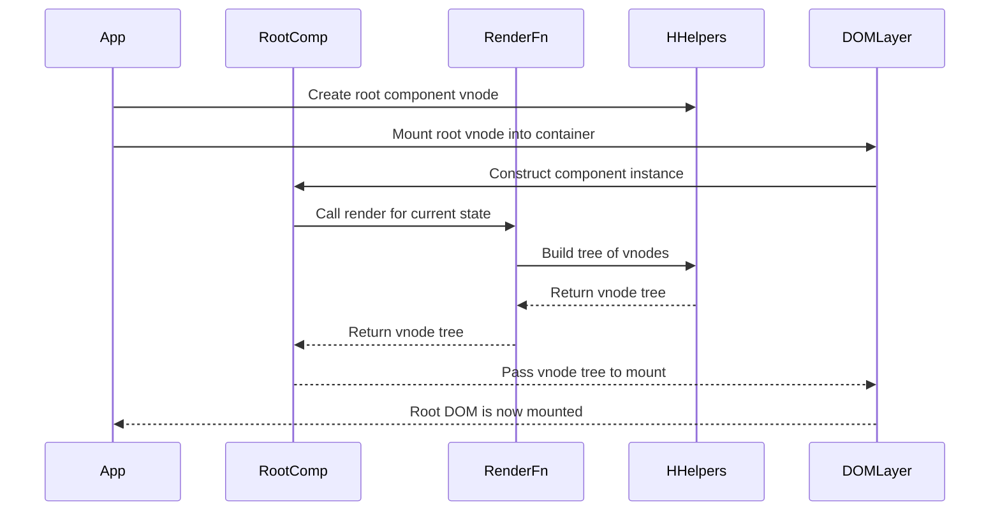

# Chapter 2: h / hString / hFragment / hSlot

Imagine you want a button that increments a counter.

You *could* do this:

```js
const button = document.createElement('button')
button.textContent = 'Clicked 0 times'
// ...later, when state changes...
button.textContent = 'Clicked 1 time'
```

Now add a `<span>` for the number. Then a title above. Then conditionally show a warning. Then nest this whole thing in a reusable “CounterCard” component.

Very quickly:

- You are manually juggling `createElement`, `append`, `textContent`, and `remove`.
- You have to remember *which* DOM node belongs to *which* piece of state.
- You’re rewriting the same wiring-again-and-again.

In [Chapter 1: VNode / DOM_TYPES](01_vnode_dom_types.md) you saw the solution: **describe** your UI as a tree of VNodes, and let other functions (`mountDOM`, `patchDOM`, `destroyDOM`) deal with the messy DOM details.

But writing VNodes by hand is awkward:

```js
// legal but painful
const view = {
  type: 'element',
  tag: 'button',
  props: { id: 'save-btn' },
  children: [
    { type: 'text', value: 'Save' },
  ],
}
```

You don’t want to build every brick by hand. You want **Lego molds**.

This chapter introduces those molds:

- `h` – mold for **elements and components**
- `hString` – mold for **text nodes**
- `hFragment` – mold for **groups with no wrapper**
- `hSlot` – mold for **placeholders where someone else’s content will go**

By the end, you’ll be writing render functions that feel close to JSX, but using only plain JavaScript.

---

## 1. The four molds: big picture

From [Chapter 1](01_vnode_dom_types.md) you know a VNode is a plain object with a `type` from `DOM_TYPES`.

These helpers create those objects for you:

- **`h(tag, props, children)`**  
  - If `tag` is a **string** (e.g. `'div'`), you get an `ELEMENT` VNode.  
  - If `tag` is a **function/class** (a component), you get a `COMPONENT` VNode.

- **`hString(text)`**  
  - Always produces a `TEXT` VNode.

- **`hFragment(children)`**  
  - Produces a `FRAGMENT` VNode – multiple children, no extra wrapper in the DOM.

- **`hSlot(children?)`**  
  - Produces a `SLOT` VNode – a **named hole** that `fillSlots` will later fill.  
  - Default content comes from the optional `children`.

You will use them constantly inside:

- plain view code (e.g. `createApp` uses `h` on the root component)
- component render functions (see [defineComponent / Component](03_definecomponent_component.md))
- routing-related components (see [HashRouter / RouterLink / RouterOutlet](07_hashrouter_routerlink_routeroutlet.md))

---

## 2. `h`: your main UI building function

Think of `h` as “HTML, but in JavaScript”:

```js
import { h } from './h'

// <button id="save-btn">Save</button>
const vdom = h('button', { id: 'save-btn' }, ['Save'])
```

### 2.1 What `h` actually creates

From `h.js`:

```js
export function h(tag, props = {}, children = []) {
  const type =
    typeof tag === 'string' ? DOM_TYPES.ELEMENT : DOM_TYPES.COMPONENT

  assert(
    typeof props === 'object' && !Array.isArray(props),
    '[vdom] h() expects an object as props (2nd argument)'
  )
  assert(
    Array.isArray(children),
    `[vdom] h() expects an array of children (3rd argument), but got '${typeof children}'`
  )

  return {
    tag,
    props,
    type,
    children: mapTextNodes(withoutNulls(children)),
  }
}
```

Piece by piece:

1. **Figure out what kind of node it is**

   ```js
   const type =
     typeof tag === 'string' ? DOM_TYPES.ELEMENT : DOM_TYPES.COMPONENT
   ```

   - `'div'`, `'button'`, `'span'` → `ELEMENT`.
   - A function/class (a component from `defineComponent`) → `COMPONENT`.

   Like a factory line: the first check is “is this a brick or a kit of bricks?”.

2. **Defensive checks**

   ```js
   assert(
     typeof props === 'object' && !Array.isArray(props),
     '[vdom] h() expects an object as props (2nd argument)'
   )
   assert(
     Array.isArray(children),
     `[vdom] h() expects an array of children (3rd argument), but got '${typeof children}'`
   )
   ```

   - `props` must be a plain object (not `null`, not an array).
   - `children` must be an array.

   These checks fail **early**, before the DOM layer tries to interpret nonsense.

3. **Clean and normalize children**

   ```js
   return {
     tag,
     props,
     type,
     children: mapTextNodes(withoutNulls(children)),
   }
   ```

   Two helpers:

   - `withoutNulls(children)` – removes `null`/`undefined` entries  
     Useful if you do `condition ? child : null`.
   - `mapTextNodes(...)` – converts strings, numbers, booleans, etc., into `TEXT` VNodes via `hString`.

   So you can write:

   ```js
   h('button', null, [
     'Clicked ',
     this.state.count,
     ' times',
   ])
   ```

   and you will get three `TEXT` children, **not** raw JS values.

### 2.2 Element vs component usage

#### Element example

```js
// <a href="/about" class="link">About</a>
const aboutLink = h(
  'a',
  { href: '/about', class: 'link' },
  ['About']
)
```

After `h`:

- `type: 'element'`
- `tag: 'a'`
- `props: { href: '/about', class: 'link' }`
- `children: [ { type: 'text', value: 'About' } ]`

Later, `mountDOM` looks at `type` and does `document.createElement('a')`, applies attributes and children. See [mountDOM / destroyDOM / patchDOM](04_mountdom_destroydom_patchdom.md) for that part.

#### Component example

Say you defined a component (we’ll see `defineComponent` fully next chapter, but this is enough for now):

```js
import { defineComponent } from './component'
import { h } from './h'

const Counter = defineComponent({
  state() {
    return { count: 0 }
  },
  render() {
    return h('button', {
      on: {
        click: () => this.updateState({ count: this.state.count + 1 }),
      },
    }, [`Clicked ${this.state.count} times`])
  },
})
```

Using `h` with this component:

```js
const vdom = h(Counter, { key: 'main-counter' }, [])
```

Now:

- `type: 'component'`
- `tag: Counter` (the constructor)
- `props: { key: 'main-counter' }`
- `children: []` (used later as slot content)

`mountDOM` will create a `Component` instance, mount it, and wire it up. Patching will use the `key` to compare list items (see `areNodesEqual` in `nodes-equal.js` and [mountDOM / destroyDOM / patchDOM](04_mountdom_destroydom_patchdom.md)).

---

## 3. Props: attributes, events, class, style

`props` on element VNodes become:

- HTML attributes
- classes
- inline styles
- DOM event listeners

### 3.1 Attributes and classes

Any normal key (not `on`, not `style`) is treated as an attribute:

```js
h('input', {
  id: 'username',
  type: 'text',
  placeholder: 'Your name',
})
```

Later, `mountDOM` calls `setAttributes` to apply them.

Classes can be:

```js
h('div', { class: 'panel primary' })
h('div', { class: ['panel', 'primary'] })
```

Diffing logic (`patchClasses` in `patch-dom.js`) treats both forms nicely. It knows how to add/remove classes efficiently by comparing arrays/strings.

### 3.2 Style

Inline styles are an object:

```js
h('div', {
  style: {
    color: 'red',
    backgroundColor: 'black',
  },
})
```

`patchStyles` later figures out which properties changed.

### 3.3 Events

Events live under the `on` key:

```js
h('button', {
  on: {
    click: (event) => {
      console.log('Clicked', event)
    },
  },
}, ['Click me'])
```

When this VNode is mounted:

- `mountDOM` extracts props and events via `extractPropsAndEvents`.
- `addEventListeners` in `events.js` adds listeners to the real DOM element.
- If a `hostComponent` is passed, the listener’s `this` is bound to the component instance (see `addEventListener`).

Patching logic can later update, add, or remove event listeners without rebuilding the element.

---

## 4. `hString`: text VNodes

Sometimes you want explicit control over text nodes, or you’re writing helpers that should deal in VNodes only.

`hString` is the small mold just for text:

```js
import { hString } from './h'

const labelText = hString('Username')
```

From `h.js`:

```js
export function hString(str) {
  return { type: DOM_TYPES.TEXT, value: String(str) }
}
```

- Always sets `type: 'text'`.
- Forces the value into a string with `String(str)` to avoid surprises.

You *could* use only `hString` for text, but as you saw, `h` and `hFragment` will convert primitive children (string, number, boolean, bigint, symbol) for you automatically via `mapTextNodes`.

Example with mixed content:

```js
h('p', null, [
  'You have ',
  3,
  ' unread messages.',
])
```

Internally becomes:

```js
[
  hString('You have '),
  hString(3),
  hString(' unread messages.')
]
```

---

## 5. `hFragment`: multiple siblings, no wrapper

HTML insists on a single root element inside a component if you’re writing markup. But in many layouts, extra wrappers are toxic:

- They break flexbox or grid.
- They change CSS selectors.
- They add unwanted margins or display behavior.

Fragments solve that: multiple siblings **as if** they were top-level, no `<div>` in the way.

### 5.1 Creating a fragment

```js
import { h, hFragment, hString } from './h'

const header = hFragment([
  h('h1', null, [hString('Welcome')]),
  h('p', null, [hString('This is the intro')]),
])
```

From `h.js`:

```js
export function hFragment(vNodes) {
  assert(
    Array.isArray(vNodes),
    '[vdom] hFragment() expects an array of vNodes'
  )

  return {
    type: DOM_TYPES.FRAGMENT,
    children: mapTextNodes(withoutNulls(vNodes)),
  }
}
```

Again:

- Enforces `children` is an array.
- Removes nulls.
- Normalizes text children.

### 5.2 How fragments end up in the DOM

`mountDOM`’s fragment case:

```js
function createFragmentNodes(vdom, parentEl, index, hostComponent) {
  const { children } = vdom
  vdom.el = parentEl

  for (const child of children) {
    mountDOM(child, parentEl, index, hostComponent)

    if (index == null) {
      continue
    }

    switch (child.type) {
      case DOM_TYPES.FRAGMENT:
        index += child.children.length
        break
      case DOM_TYPES.COMPONENT:
        index += child.component.elements.length
        break
      default:
        index++
    }
  }
}
```

Key points:

- Fragments themselves don’t get a DOM wrapper; `vdom.el` is set to the **parent element**.
- Their children are inserted directly into `parentEl`.
- The `index` math keeps siblings in the right order even when children are nested fragments or components.

`extractChildren` in `h.js` also flattens nested fragments when patching:

```js
export function extractChildren(vdom) {
  if (vdom.children == null) {
    return []
  }

  const children = []

  for (const child of vdom.children) {
    if (child.type === DOM_TYPES.FRAGMENT) {
      children.push(...extractChildren(child))
    } else {
      children.push(child)
    }
  }

  return children
}
```

This is heavily used by `patchChildren` in `patch-dom.js` to diff children arrays.

### 5.3 Fragments in components

In [`defineComponent / Component`](03_definecomponent_component.md), components can return fragments from their `render` functions to have **multiple root nodes**:

```js
render() {
  return hFragment([
    h('h1', null, ['Title']),
    h('button', { on: { click: this.handleClick } }, ['Click']),
  ])
}
```

The `Component.elements` getter knows how to walk fragments and component children to return all real DOM elements for the component:

```js
if (this.#vdom.type === DOM_TYPES.FRAGMENT) {
  return extractChildren(this.#vdom).flatMap((child) => {
    if (child.type === DOM_TYPES.COMPONENT) {
      return child.component.elements
    }

    return [child.el]
  })
}
```

So other parts of the system can still find “the first element” or “all elements” of a component, even with fragments at the top.

---

## 6. `hSlot`: holes for external content

Imagine a reusable `Card` component:

- The card owns the border, padding, background.
- The caller decides the **content**.

In HTML terms, Web Components use `<slot>`. In this framework, you use `hSlot`.

### 6.1 Creating a slot in a component

Look at `RouterLink` in `router-components.js`:

```js
import { defineComponent } from './component'
import { h, hSlot } from './h'

export const RouterLink = defineComponent({
  render() {
    const { to } = this.props

    return h(
      'a',
      {
        href: to,
        on: {
          click: (e) => {
            e.preventDefault()
            this.appContext.router.navigateTo(to)
          },
        },
      },
      [hSlot()]
    )
  },
})
```

Usage might look like:

```js
h(RouterLink, { to: '/home' }, ['Go home'])
```

Conceptually:

- `RouterLink` controls the outer `<a>` and the click behavior.
- Whatever you pass as children (`'Go home'`) gets inserted into the `<a>` where `hSlot()` was placed.

### 6.2 What `hSlot` returns

From `h.js`:

```js
let hSlotCalled = false

export function hSlot(children = []) {
  hSlotCalled = true
  return { type: DOM_TYPES.SLOT, children }
}
```

And two helper functions:

```js
export function didCreateSlot() {
  return hSlotCalled
}

export function resetDidCreateSlot() {
  hSlotCalled = false
}
```

The idea:

- Every time a component’s `render()` calls `hSlot()`, the global flag flips to `true`.
- After rendering, the component logic can check `didCreateSlot()` to decide whether it needs to traverse the VNode tree and replace slots with real content.
- When done, it calls `resetDidCreateSlot()` to avoid affecting the next render.

### 6.3 How slot filling works

The component class in `component.js` uses this in `render()`:

```js
render() {
  const vdom = render.call(this)

  if (didCreateSlot()) {
    fillSlots(vdom, this.#children)
    resetDidCreateSlot()
  }

  return vdom
}
```

- `this.#children` is the array of **external content** passed from the parent:

  ```js
  setExternalContent(children) {
    this.#children = children
  }
  ```

- `fillSlots` (from `slots.js`) traverses the VNode tree and performs an **in‑place replacement**:

  ```js
  function insertViewInSlot(node, parent, index, externalContent) {
    if (node.type !== DOM_TYPES.SLOT) return

    const defaultContent = node.children
    const views =
      externalContent.length > 0 ? externalContent : defaultContent

    const hasContent = views.length > 0
    if (hasContent) {
      parent.children.splice(index, 1, hFragment(views))
    } else {
      parent.children.splice(index, 1)
    }
  }
  ```

Important details:

- Slot nodes are **never** mounted directly. `mountDOM` doesn’t know what to do with `DOM_TYPES.SLOT` and will throw if it encounters one.
- Slot content is always wrapped in a **fragment** (`hFragment(views)`) so that:
  - You can pass multiple VNodes as content.
  - The insertion behaves like “drop these siblings here”.

So:

```js
h(Parent, null, [
  h('strong', null, ['Bold']),
  h('span', null, ['Text']),
])
```

becomes, inside the parent’s VNode tree:

- At the slot location, a `FRAGMENT` whose children are `strong` and `span`.

### 6.4 Putting it together: a simple Card with slots

A minimal Card-like component:

```js
import { defineComponent } from './component'
import { h, hSlot } from './h'

export const Card = defineComponent({
  render() {
    return h('div', { class: 'card' }, [
      h('div', { class: 'card-body' }, [hSlot()]),
    ])
  },
})
```

Used as:

```js
h(Card, null, [
  h('p', null, ['Content inside card']),
])
```

Render steps:

1. Parent uses `h(Card, null, [...children...])`.  
2. `mountDOM` sees a `COMPONENT`, creates a `Component` instance, and calls `setExternalContent(children)`.
3. Card’s `render()` returns a tree with a `SLOT` node inside.
4. `didCreateSlot()` is `true`, so `fillSlots` replaces that `SLOT` with a fragment containing the external paragraph.
5. `mountDOM` then proceeds to mount the modified VNode tree (no `SLOT` nodes left; just elements, text, fragments).

---

## 7. How these helpers fit into the whole flow

To see the helpers in context, here’s a small sequence that happens when the app starts and renders a root component.

We’ll use five participants:

- `App` – the `createApp` wrapper
- `RootComp` – the root component class
- `RenderFn` – the root component’s render function
- `HHelpers` – our `h` / `hString` / `hFragment` / `hSlot`
- `DOMLayer` – everything that mounts and patches DOM (`mountDOM`, `patchDOM`, `destroyDOM`)



The critical role of the helpers:

- They convert *your* render logic into **well‑formed VNodes**.
- Those VNodes carry `DOM_TYPES` labels introduced in [VNode / DOM_TYPES](01_vnode_dom_types.md).
- The DOM layer and the component system rely on this structure being consistent.

Without `h`/`hString`/`hFragment`/`hSlot`, you’d either:

- Hand‑build all VNodes, or
- Mix DOM and state logic directly, which is exactly what this framework is trying to lift off your shoulders.

---

## 8. Recap

We’ve turned raw VNode objects into friendly **Lego molds**:

- **`h(tag, props, children)`**
  - Builds `ELEMENT` VNodes when `tag` is a string.
  - Builds `COMPONENT` VNodes when `tag` is a component constructor.
  - Cleans children (`null` removal, text normalization).
  - Carries attributes, events, classes, and styles in `props`.

- **`hString(text)`**
  - Simple, explicit `TEXT` VNode creator.

- **`hFragment(children)`**
  - Groups sibling VNodes without adding a wrapper in the DOM.
  - Lets components have multiple root nodes cleanly.

- **`hSlot(children?)`**
  - Marks a hole for external content, with optional default content.
  - Sets a global flag so components can efficiently decide whether slot filling is needed.
  - Gets replaced with a fragment containing external or default content by `fillSlots`.

With these helpers, writing a render function becomes “describe the UI in VNode form”, not “mutate the DOM in exactly the right order”.

In the next chapter, [defineComponent / Component](03_definecomponent_component.md), you’ll use these helpers inside real components with state and lifecycle:

- How `defineComponent` wraps your `render` function.
- How `Component` instances call `render`, patch the DOM, and run `onMounted`/`onUnmounted`.
- How props, state, slots, and events come together in everyday component code.

That is where the molds you just learned become full‑blown, reactive UI building blocks.