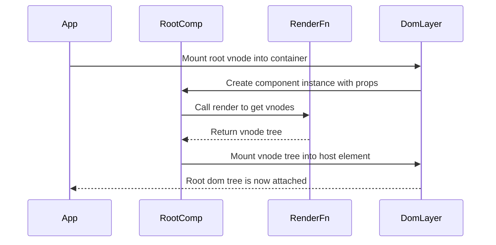

# Chapter 3: defineComponent / Component

Imagine you have your nice VNode “blueprints” from [VNode / DOM_TYPES](01_vnode_dom_types.md), and you know how to build them with `h` from [h / hString / hFragment / hSlot](02_h_hstring_hfragment_hslot.md).

You can already describe **what** the UI should look like.

But what happens when:

- The number in a counter should go up when you click  
- A modal should appear, then disappear  
- A router outlet should react when the URL changes  

You need a place where **state lives**, where **methods** can change it, and where a **render function** can turn that state into VNodes, over and over.

This is what `defineComponent` and the `Component` class are for.

They’re like writing a **recipe** (render + behavior), and the framework gives you a **Chef class** back. Every Chef instance:

- Has its own ingredients (props + state)  
- Follows the same recipe (`render`, methods, lifecycle)  
- Cooks its own dish (its piece of the DOM tree) independently  

---

## 1. What problem are components solving?

Consider a super-minimal counter built only with `h` and some plain functions:

```js
import { h } from './h'

let count = 0

function renderCounter() {
  return h('button', { on: { click: onClick } }, [`Clicked ${count} times`])
}

function onClick() {
  count++
  // Now what?
}
```

When `onClick` runs:

- `count` changes
- But the DOM doesn’t magically re-render
- You’d have to manually call your own “rerender” function
- And that function would need to know:
  - Where in the DOM the old VNodes live  
  - How to run `patchDOM` correctly  
  - How to clean up when elements go away  

Quickly, every piece of interactive UI turns into spaghetti: global variables, manual calls to re-render, manual cleanup.

We want something more like:

```js
const Counter = defineComponent({
  state() {
    return { count: 0 }
  },

  render() {
    return h('button', {
      on: {
        click: () => this.updateState({ count: this.state.count + 1 }),
      },
    }, [`Clicked ${this.state.count} times`])
  },
})
```

And then let the framework worry about:

- Creating instances  
- Mounting them into the DOM  
- Re-rendering on state or prop changes  
- Patching the DOM with [mountDOM / destroyDOM / patchDOM](04_mountdom_destroydom_patchdom.md)  
- Running lifecycle hooks like `onMounted` and `onUnmounted`

That is exactly what `defineComponent` does.

---

## 2. The shape of a component definition

You create a component by calling `defineComponent` with an object describing the recipe:

```js
import { defineComponent } from './component'
import { h } from './h'

export const Counter = defineComponent({
  state(props) {
    return { count: props.initial ?? 0 }
  },

  render() {
    const { count } = this.state

    return h('button', {
      on: {
        click: () => this.updateState({ count: count + 1 }),
      },
    }, [`Clicked ${count} times`])
  },
})
```

The object you pass to `defineComponent` can contain:

- `state(props)` – returns the initial state object  
- `render()` – returns a VNode tree using `h` / `hFragment` / `hSlot`  
- `onMounted()` – runs after the component is mounted (lifecycle)  
- `onUnmounted()` – runs after the component is destroyed (lifecycle)  
- Any additional keys – become **instance methods**, accessible as `this.methodName()`

Formally (from the JSDoc in `component.js`, simplified):

```js
/**
 * @typedef DefineComponentArgs
 * @type {object}
 * @property {function} render
 * @property {(props: Object?) => Object} state
 * @property {() => Promise<void>|void} onMounted
 * @property {() => Promise<void>|void} onUnmounted
 * @property {Object<string, Function>} methods
 */
```

`defineComponent(definition)` returns a **class** called `Component` (a constructor function in JS terms). You rarely instantiate it yourself; the framework does it for you when you use the component as a `tag` in `h`:

```js
import { h } from './h'
import { Counter } from './Counter'

// Inside some other render function
const vdom = h(Counter, { initial: 10 })
```

That `h(Counter, ...)` call produces a VNode of type `DOM_TYPES.COMPONENT`. Then [mountDOM / destroyDOM / patchDOM](04_mountdom_destroydom_patchdom.md) knows: “Ah, this is a component, I must create a `Component` instance”.

---

## 3. What `defineComponent` actually builds

Let’s look at a trimmed-down version of `defineComponent` to understand the pieces.

### 3.1 The high-level function

```js
export function defineComponent({
  render,
  state,
  onMounted = emptyFn,
  onUnmounted = emptyFn,
  ...methods
}) {
  class Component {
    // private fields, constructor, methods...
  }

  for (const methodName in methods) {
    Component.prototype[methodName] = methods[methodName]
  }

  return Component
}
```

Piece by piece:

1. **Destructure the definition**

   - `render`, `state`, `onMounted`, `onUnmounted` are pulled out.
   - Any other keys go into `methods` (rest object).

2. **Create a `Component` class**

   - All instances share the same logic (render, lifecycle, helper methods).
   - Each instance has its own `props`, `state`, and internal fields.

3. **Attach user methods**

   If you pass:

   ```js
   defineComponent({
     state() { return {} },
     render() { /*...*/ },
     increment() { /*...*/ },
   })
   ```

   Then `increment` gets attached to `Component.prototype.increment`, so you can call `this.increment()` inside `render` or other methods.

4. **Return the class**

   That class is your *component type* — the “Chef recipe”.

---

## 4. What a Component instance looks like

Inside `defineComponent`, the `Component` class is defined. It has:

- Public fields:
  - `props`
  - `state`
- Private fields (prefixed with `#` in the source):
  - `#vdom` – current VNode tree
  - `#hostEl` – actual DOM parent element where this component is mounted
  - `#isMounted` – has this instance been mounted?
  - `#children` – external VNodes for slots
  - `#dispatcher` and subscriptions – for `emit` and parent event handlers
  - `#appContext` – shared app-level context (router, etc.)

You don’t need to memorize them, but it helps to know what the instance is managing for you.

### 4.1 Constructor: props and initial state

From `component.js`:

```js
constructor(props = {}, eventHandlers = {}, parentComponent = null) {
  this.props = props
  this.state = state ? state(props) : {}
  this.#eventHandlers = eventHandlers
  this.#parentComponent = parentComponent
}
```

Key ideas:

- Each instance receives its own **props** object.
- It calls your `state(props)` function once to get the initial `state`.
- It stores:
  - `eventHandlers` – functions that the parent passes to listen to child events (see [Dispatcher and component events (emit)](05_dispatcher_and_component_events_emit.md)).
  - `parentComponent` – used when calling event handlers so `this` inside them refers to the parent.

Analogy: when a new Chef starts work, they get a written order (`props`) and assemble their first prep set (`state`) based on that order.

---

## 5. Rendering and updating: from state to DOM

The heart of `Component` is the render-and-patch cycle.

### 5.1 Calling your `render()` with the right `this`

The component instance has its own `render` method that wraps your definition’s `render`:

```js
render() {
  const vdom = render.call(this)

  if (didCreateSlot()) {
    fillSlots(vdom, this.#children)
    resetDidCreateSlot()
  }

  return vdom
}
```

What happens here:

- `render.call(this)` runs your render function with `this` bound to the Component instance:
  - You can access `this.props`, `this.state`, `this.appContext`
  - You can call `this.updateState(...)`, `this.emit(...)`, your custom methods, etc.
- After that, the framework checks `didCreateSlot()` (from `hSlot` in [h / hString / hFragment / hSlot](02_h_hstring_hfragment_hslot.md)):
  - If you used any `hSlot()` calls, `fillSlots` walks the VNode tree and replaces those slots with the provided external content.
- The final VNode tree is returned.

Render functions always return **VNodes**, never real DOM. The actual DOM work is delegated to [mountDOM / destroyDOM / patchDOM](04_mountdom_destroydom_patchdom.md).

### 5.2 Mounting a component instance

When `mountDOM` meets a component VNode, it calls `createComponentNode`:

```js
function createComponentNode(vdom, parentEl, index, hostComponent) {
  const { tag: Component, children } = vdom
  const { props, events } = extractPropsAndEvents(vdom)
  const component = new Component(props, events, hostComponent)

  component.setExternalContent(children)
  component.setAppContext(hostComponent?.appContext ?? {})

  component.mount(parentEl, index)
  vdom.component = component
  vdom.el = component.firstElement
}
```

From the component instance side, `mount` looks like:

```js
mount(hostEl, index = null) {
  if (this.#isMounted) {
    throw new Error('Component is already mounted')
  }

  this.#vdom = this.render()
  mountDOM(this.#vdom, hostEl, index, this)
  this.#wireEventHandlers()

  this.#isMounted = true
  this.#hostEl = hostEl
}
```

Summary:

- The instance calls its own `render()` → gets a VNode tree.
- `mountDOM` mounts that VNode tree into `hostEl` at `index`.
- Event handlers for `emit` are wired using the `Dispatcher`.
- Flags and references are updated (`#isMounted`, `#hostEl`, `#vdom`).
- Back in `mountDOM`, `vdom.component` is set, and `vdom.el` points at the **first real DOM element** of this component (important for moving components around in [patchDOM](04_mountdom_destroydom_patchdom.md)).

### 5.3 Updating state and props

A key promise of components: **you never re-render manually**. You just call:

- `this.updateState({ ... })` to change state
- Or, from outside, `childComponent.updateProps({ ... })` to change props

And the component takes care of re-rendering and patching.

#### 5.3.1 `updateState`

```js
updateState(state) {
  this.state = { ...this.state, ...state }
  this.#patch()
}
```

This:

1. Shallow-merges the new state into the existing `this.state`.
2. Calls a private `#patch()` method.

`#patch()` is where VNode diffing kicks in:

```js
#patch() {
  if (!this.#isMounted) {
    throw new Error('Component is not mounted')
  }

  const vdom = this.render()
  this.#vdom = patchDOM(this.#vdom, vdom, this.#hostEl, this)
}
```

- Calls `render()` again to get a new VNode tree.
- Calls `patchDOM(oldVdom, newVdom, hostEl, this)`:
  - That function compares VNodes (using `areNodesEqual` from `nodes-equal.js`).
  - It updates DOM nodes using the diff logic you’ll see in detail in [mountDOM / destroyDOM / patchDOM](04_mountdom_destroydom_patchdom.md).
- Stores the new VNode as `#vdom` for future patches.

You never touch the DOM directly here; you just update `this.state`.

#### 5.3.2 `updateProps`

Props follow the same pattern, but are meant to be updated by the parent, not by the component itself:

```js
updateProps(props) {
  this.props = { ...this.props, ...props }
  this.#patch()
}
```

`patchComponent` in `patch-dom.js` calls this for you when a parent’s render produces a new component VNode:

```js
function patchComponent(oldVdom, newVdom) {
  const { component } = oldVdom
  const { children } = newVdom
  const { props } = extractPropsAndEvents(newVdom)

  component.setExternalContent(children)
  component.updateProps(props)

  newVdom.component = component
  newVdom.el = component.firstElement
}
```

So you can think:

- Parent re-renders → produces new VNodes for children.
- For each component child, `patchDOM`:
  - Updates its `props`
  - Updates its external slot content
  - Lets that child handle its own patching via `updateProps` and `#patch`.

---

## 6. Lifecycle: mounting and unmounting hooks

Many components need to do side work:

- Subscribe to router events  
- Start timers  
- Attach global listeners  

Then undo that work when they disappear.

`defineComponent` lets you provide two lifecycle hooks:

- `onMounted()` – runs after DOM is mounted and event wiring is done
- `onUnmounted()` – runs after DOM is destroyed

You define them like:

```js
export const Clock = defineComponent({
  state() {
    return { time: new Date().toLocaleTimeString(), timerId: null }
  },

  onMounted() {
    const id = setInterval(() => {
      this.updateState({
        time: new Date().toLocaleTimeString(),
      })
    }, 1000)

    this.updateState({ timerId: id })
  },

  onUnmounted() {
    clearInterval(this.state.timerId)
  },

  render() {
    return h('div', null, [`Time: ${this.state.time}`])
  },
})
```

How are these called?

- `mountDOM` schedules `component.onMounted()` with the scheduler:

  ```js
  createComponentNode(...)
  enqueueJob(() => vdom.component.onMounted())
  ```

- `destroyDOM` does something similar for unmount:

  ```js
  case DOM_TYPES.COMPONENT: {
    vdom.component.unmount()
    enqueueJob(() => vdom.component.onUnmounted())
    break
  }
  ```

And inside the component:

```js
onMounted() {
  return Promise.resolve(onMounted.call(this))
}

onUnmounted() {
  return Promise.resolve(onUnmounted.call(this))
}
```

So:

- Your hooks run with `this` bound to the component instance.
- They can be async or sync. The framework wraps them in `Promise.resolve`.

---

## 7. Slots and external content

From [h / hString / hFragment / hSlot](02_h_hstring_hfragment_hslot.md) and [Slots and fillSlots](06_slots_and_fillslots.md), you know:

- `hSlot()` is a placeholder for content that the parent passes as children.
- `fillSlots` walks the component’s VNode tree and swaps `SLOT` nodes with actual content.

How does the component know which external content belongs to it?

### 7.1 Saving children as external content

When `mountDOM` creates a component node:

```js
const { tag: Component, children } = vdom
// ...
const component = new Component(props, events, hostComponent)
component.setExternalContent(children)
```

The instance stores those in a private field:

```js
setExternalContent(children) {
  this.#children = children
}
```

During render, if the component created any slot nodes, `fillSlots` uses `this.#children` as the external content to insert:

```js
render() {
  const vdom = render.call(this)

  if (didCreateSlot()) {
    fillSlots(vdom, this.#children)
    resetDidCreateSlot()
  }

  return vdom
}
```

When props change via `patchComponent`, the new external children are set again:

```js
component.setExternalContent(children)
component.updateProps(props)
```

So from inside your component all you do is:

```js
import { h, hSlot } from './h'

const Card = defineComponent({
  render() {
    return h('div', { class: 'card' }, [
      h('div', { class: 'card-body' }, [hSlot()]),
    ])
  },
})
```

And from outside:

```js
h(Card, null, [
  h('p', null, ['Hello inside card']),
])
```

The wiring of which children go into which slot is handled automatically by the component infrastructure and `fillSlots`.

---

## 8. Components as DOM “islands”: elements and offset

Sometimes other code needs to know:

- Which real DOM elements make up this component’s root(s)?
- Where exactly in the parent they start?

For example, `patchChildren` in `patch-dom.js` must move components around (including those with fragment roots).

The `Component` class exposes two getters for this:

### 8.1 `elements`: all root DOM elements

```js
get elements() {
  if (this.#vdom == null) {
    return []
  }

  if (this.#vdom.type === DOM_TYPES.FRAGMENT) {
    return extractChildren(this.#vdom).flatMap((child) => {
      if (child.type === DOM_TYPES.COMPONENT) {
        return child.component.elements
      }

      return [child.el]
    })
  }

  return [this.#vdom.el]
}
```

If the top-level VNode is:

- A single `ELEMENT` – `elements` is `[thatElement]`.
- A `FRAGMENT` – it flattens children:
  - If a child is a component, returns its own `elements`.
  - Otherwise returns that child’s `el`.

This lets `mountDOM` and `patchDOM` treat a component as a **block** of DOM siblings, whether it has 1 root node or 10.

### 8.2 `firstElement` and `offset`

Two more helpers:

```js
get firstElement() {
  return this.elements[0]
}

get offset() {
  if (this.#vdom.type === DOM_TYPES.FRAGMENT) {
    return Array.from(this.#hostEl.children).indexOf(this.firstElement)
  }

  return 0
}
```

- `firstElement` – useful when inserting or moving an entire component. `mountDOM` sets `vdom.el = component.firstElement` for component VNodes.
- `offset` – for fragment-rooted components, gives the index of the first element in the parent’s children. `patchChildren` uses this to adjust indices when diffing children inside components.

You rarely use these manually, but they’re vital glue for the diffing algorithm you’ll explore in [mountDOM / destroyDOM / patchDOM](04_mountdom_destroydom_patchDOM.md).

---

## 9. A full journey: from app to component to DOM

To tie everything together, here’s a small scenario:

- You call `createApp(RootComponent, props)` from [createApp / Application context](10_createapp_application_context.md).
- The app mounts, which causes:
  - A root VNode `h(RootComponent, props)` to be created.
  - `mountDOM` to see a component VNode.
  - A `RootComponent` instance to be created and mounted.

Here is that flow as a sequence diagram.



Inside that invisible `Render` box, your `render` uses `h`, `hFragment`, `hSlot` exactly as described in [h / hString / hFragment / hSlot](02_h_hstring_hfragment_hslot.md). And inside `DOM`, all the logic from [mountDOM / destroyDOM / patchDOM](04_mountdom_destroydom_patchdom.md) is responsible for actually touching the real DOM.

---

## 10. Putting it all together: a small interactive example

Here is a tiny, self-contained component using most of what we covered:

```js
import { defineComponent } from './component'
import { h } from './h'

export const ToggleMessage = defineComponent({
  state() {
    return { visible: true }
  },

  onMounted() {
    console.log('ToggleMessage mounted')
  },

  onUnmounted() {
    console.log('ToggleMessage unmounted')
  },

  toggle() {
    this.updateState({ visible: !this.state.visible })
  },

  render() {
    const { visible } = this.state

    return h('div', null, [
      h('button', {
        on: { click: () => this.toggle() },
      }, ['Toggle']),

      visible ? h('p', null, ['Hello there']) : null,
    ])
  },
})
```

Once this component is used as `h(ToggleMessage)`, everything else is automatic:

- `state()` sets `{ visible: true }`.
- `render()` returns VNodes with text and buttons.
- Clicking the button calls `this.toggle()`.
- `toggle()` uses `updateState`, which:
  - Calls `render()` again
  - Uses `patchDOM` to update only what changed (`<p>` may appear or disappear)
- `onMounted` and `onUnmounted` log lifecycle events.

You never once called `document.createElement` or `appendChild` manually.

---

## 11. Recap

In this chapter you saw how `defineComponent` and the `Component` class:

- Turn a plain object definition (`state`, `render`, lifecycle, methods) into a **component class**.
- Let you write render functions that use VNodes (`h`, `hFragment`, `hSlot`) instead of DOM APIs.
- Manage:
  - Initial state and props
  - Re-rendering on `updateState` / `updateProps`
  - Lifecycle hooks (`onMounted`, `onUnmounted`)
  - Slots and external children
  - Integration with the diffing layer and scheduler

The analogy to keep in mind:

- `defineComponent` is your **recipe**.
- The returned `Component` class is your **Chef type**.
- Each instance is a **Chef on the line** with its own ingredients (props + state) cooking its own dish (DOM subtree) from the same recipe.

Now that you know how components describe their UI and behavior, the next natural question is: **how does the framework efficiently update the real DOM when those components re-render?**

In the next chapter, [mountDOM / destroyDOM / patchDOM](04_mountdom_destroydom_patchdom.md), you’ll dive into the machinery that:

- Builds DOM from VNodes the first time
- Diffs old and new VNode trees
- Applies minimal changes to the browser DOM  
- Cleans everything up when components go away