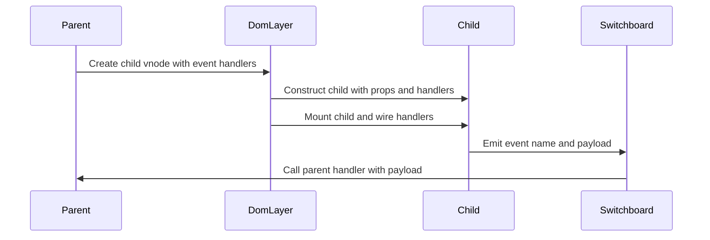

# Chapter 5: Dispatcher and component events (emit)

Imagine a child component that wants to “tell” its parent something:

- A `<TodoItem>` toggles from incomplete to complete.  
- A `<Modal>` reports that the user clicked “Confirm”.  
- A `<SearchBox>` announces that the user submitted a query.

You *could* pass a function down as a prop and call it directly:

```js
// Parent render
h(TodoItem, { onToggle: (id) => this.handleToggle(id) })
```

```js
// Child
this.props.onToggle(this.props.id)
```

This *works*, but it couples the child tightly to the parent’s prop names and structure. As your app grows, these “callback props” multiply and your components start to look like electrical panels full of wires.

This framework takes a slightly different approach inside components: a tiny **Dispatcher** that acts like a **message switchboard** between a child and whoever cares about its events.

- Children **emit** named events with `this.emit('save', payload)`.  
- Parents **subscribe** to those names when they create the child.  
- The Dispatcher inside the child delivers the message in order to all subscribers, and the parent’s handler runs in the right context.

In this chapter you’ll see:

- How the generic [`Dispatcher`](./dispatcher.js) works (pub/sub in miniature).  
- How `defineComponent` wires a `Dispatcher` into each component instance.  
- How `emit` lets a child send messages to its parent without knowing who listens.  
- How parents pass event handlers down using `h` (from [h / hString / hFragment / hSlot](02_h_hstring_hfragment_hslot.md)).  
- How this fits with the rest of the framework (state, VNodes, DOM updates).

---

## 1. Why not just call parent methods directly?

Picture a tree of components:

- `App`  
  - `TodoList`  
    - `TodoItem` x 100

When a `TodoItem` toggles, you need to update **list state** in `TodoList`, maybe also update a **summary** in `App`.

Three naive options:

1. **Direct parent calls**

   ```js
   // In TodoItem
   this.parentComponent.handleToggle(this.id)
   ```

   Problems:

   - Child must know its parent has `handleToggle`.  
   - If a new parent wraps `TodoItem`, you must keep threading calls correctly.  
   - Very tight coupling.

2. **Global event bus**

   ```js
   globalBus.dispatch('todo-toggled', { id: this.id })
   ```

   Problems:

   - Everything is global. Hard to trace who listens.  
   - Names can easily collide.  
   - Hard to test in isolation.

3. **Callback props everywhere**

   ```js
   // Parent
   h(TodoItem, { onToggle: this.handleToggle })

   // Child
   this.props.onToggle(this.props.id)
   ```

   Better, but:

   - You end up with many props like `onConfirm`, `onClose`, `onToggle`.  
   - You still tightly bind your child to prop names and shapes.

Instead, this framework gives each component a **local message switchboard**:

- The **parent** says: “If my child emits `'toggle'`, run this function.”  
- The **child** just says: “I emit `'toggle'`” with some data.  

They meet on a string name, not on a particular prop name. That’s the Dispatcher’s job.

---

## 2. The Dispatcher: a tiny in‑memory switchboard

The `Dispatcher` is a general-purpose pub/sub tool, used both:

- Inside components for `emit` (child → parent).  
- In the router for route change notifications (see [HashRouter / RouterLink / RouterOutlet](07_hashrouter_routerlink_routeroutlet.md)).

Think of it like a bulletin board:

- Each “topic” is a command name (`'toggle'`, `'save'`, `'router-event'`).  
- Subscribers pin their phone numbers under one topic.  
- When a note is posted to that topic, everyone under it gets called.

Here is the heart of `dispatcher.js`, broken into small pieces.

### 2.1 Subscribing to a named command

```js
export class Dispatcher {
  #subs = new Map()
  #afterHandlers = []

  subscribe(commandName, handler) {
    if (!this.#subs.has(commandName)) {
      this.#subs.set(commandName, [])
    }

    const handlers = this.#subs.get(commandName)
    if (handlers.includes(handler)) {
      return () => {}
    }

    handlers.push(handler)

    return () => {
      const idx = handlers.indexOf(handler)
      handlers.splice(idx, 1)
    }
  }
}
```

Key ideas:

- `#subs` maps `"commandName"` → `[handler1, handler2, ...]`.  
- `subscribe(name, handler)`:

  - Creates the array if needed.  
  - Avoids duplicate handlers.  
  - Returns an **unsubscribe function** that removes this handler.

So you can do:

```js
const dispatcher = new Dispatcher()

const unsubscribe = dispatcher.subscribe('save', (payload) => {
  console.log('Saved', payload)
})

// Later
unsubscribe()
```

### 2.2 Running “after every command” handlers

```js
afterEveryCommand(handler) {
  this.#afterHandlers.push(handler)

  return () => {
    const idx = this.#afterHandlers.indexOf(handler)
    this.#afterHandlers.splice(idx, 1)
  }
}
```

This lets something observe **all** commands, no matter the name. The router uses a single command name (`'router-event'`), so this hook isn’t heavily used there, but it’s available if you ever wanted:

- Logging: “A command just ran”  
- Metrics: increment a counter on every dispatch

Same pattern: return an unsubscribe function.

### 2.3 Dispatching a command

```js
dispatch(commandName, payload) {
  if (this.#subs.has(commandName)) {
    this.#subs.get(commandName).forEach((handler) => handler(payload))
  } else {
    console.warn(`No handlers for command: ${commandName}`)
  }

  this.#afterHandlers.forEach((handler) => handler())
}
```

Step by step:

1. If there are subscribers for `commandName`, call them in order with `payload`.  
2. Otherwise log a warning.  
3. Call every `afterEveryCommand` handler.

Note that `Dispatcher` does **not** know or care about components or DOM. It is just a map of names to functions plus a method to run them.

---

## 3. Wiring Dispatcher into components

In [defineComponent / Component](03_definecomponent_component.md), each component instance gets its **own** Dispatcher:

```js
class Component {
  #dispatcher = new Dispatcher()
  #subscriptions = []
  #eventHandlers = null
  #parentComponent = null

  constructor(props = {}, eventHandlers = {}, parentComponent = null) {
    this.props = props
    this.state = state ? state(props) : {}
    this.#eventHandlers = eventHandlers
    this.#parentComponent = parentComponent
  }

  emit(eventName, payload) {
    this.#dispatcher.dispatch(eventName, payload)
  }
}
```

So when you call `this.emit(...)` inside a component, you’re really doing:

```js
this.#dispatcher.dispatch(eventName, payload)
```

But where do the **subscribers** come from? That’s the parent’s job.

### 3.1 Parent passes event handlers through VNode props

In [h / hString / hFragment / hSlot](02_h_hstring_hfragment_hslot.md) you saw that `h` accepts arbitrary props. For components, those props are split into:

- “Normal props” (data)  
- “Event handlers” (functions the parent wants to run when the child emits)

The splitter is `extractPropsAndEvents` (from `utils/props.js`, not shown here but conceptually simple):

- Keys starting with `on` but not DOM events? Could map to component events.  
- The book’s code treats these as event handlers passed to the component constructor.

When `mountDOM` encounters a component VNode, it does this:

```js
function createComponentNode(vdom, parentEl, index, hostComponent) {
  const { tag: Component, children } = vdom
  const { props, events } = extractPropsAndEvents(vdom)
  const component = new Component(props, events, hostComponent)

  component.setExternalContent(children)
  component.setAppContext(hostComponent?.appContext ?? {})

  component.mount(parentEl, index)
  vdom.component = component
  vdom.el = component.firstElement
}
```

Important bits:

- `events` is whatever `extractPropsAndEvents` found as **component-level event handlers** on the VNode.  
- The component instance gets that `events` object as `#eventHandlers`.  
- `parentComponent` is passed as `hostComponent`, so handlers can run with the parent as `this`.

The component then uses those handlers to subscribe to its own `Dispatcher`.

### 3.2 Subscribing parent handlers to child events

When the child component mounts, it wires handlers:

```js
mount(hostEl, index = null) {
  // ... render and mount DOM
  this.#wireEventHandlers()

  this.#isMounted = true
  this.#hostEl = hostEl
}
```

The private wiring methods:

```js
#wireEventHandlers() {
  this.#subscriptions = Object.entries(this.#eventHandlers).map(
    ([eventName, handler]) => this.#wireEventHandler(eventName, handler)
  )
}

#wireEventHandler(eventName, handler) {
  return this.#dispatcher.subscribe(eventName, (payload) => {
    if (this.#parentComponent) {
      handler.call(this.#parentComponent, payload)
    } else {
      handler(payload)
    }
  })
}
```

Walkthrough:

1. `#eventHandlers` is an object like:

   ```js
   {
     toggle: (payload) => { /* parent logic */ },
     delete: (payload) => { /* parent logic */ },
   }
   ```

2. For each `[eventName, handler]`, subscribe to the component’s dispatcher.

3. On dispatch:

   - If the component has a `#parentComponent`, call the handler with `this` bound to the **parent component instance**.  
   - Otherwise (top-level root component), just call `handler(payload)`.

4. The `subscribe` method returns an unsubscribe function, so `#subscriptions` is a list of cleanup callbacks. On unmount:

   ```js
   unmount() {
     if (!this.#isMounted) {
       throw new Error('Component is not mounted')
     }

     destroyDOM(this.#vdom)
     this.#subscriptions.forEach((unsubscribe) => unsubscribe())

     this.#vdom = null
     this.#isMounted = false
     this.#hostEl = null
     this.#subscriptions = []
   }
   ```

   All event subscriptions are removed, preventing leaks.

So each component:

- Owns a private Dispatcher.  
- Subscribes parent handlers to it during mount.  
- Unsubscribes them during unmount.  

Children never reach up manually; they just `emit`.

---

## 4. Emitting from a child component

From the child’s point of view, emitting is a single method call:

```js
emit(eventName, payload) {
  this.#dispatcher.dispatch(eventName, payload)
}
```

As the component author, you do something like:

```js
import { defineComponent } from './component'
import { h } from './h'

export const TodoItem = defineComponent({
  state() {
    return { done: false }
  },

  toggle() {
    const done = !this.state.done
    this.updateState({ done })
    this.emit('toggle', { id: this.props.id, done })
  },

  render() {
    const { done } = this.state
    const label = done ? 'Undo' : 'Complete'

    return h('button', { on: { click: () => this.toggle() } }, [label])
  },
})
```

Notes:

- `this.emit('toggle', payload)` does not know or care who is listening.  
- The event name `'toggle'` is just a **string channel**.  
- The parent decides whether to subscribe to `'toggle'` for this child.

No direct calls to parent props or methods. Your component just broadcasts: “I toggled this item.”

---

## 5. Listening from a parent component

Now the parent can create a `TodoItem` and attach handlers when it uses `h`.

Using `h` with a component VNode is described in [h / hString / hFragment / hSlot](02_h_hstring_hfragment_hslot.md). When you pass “event handlers” via props, `extractPropsAndEvents` splits them out, and `defineComponent` wires them up through the Dispatcher.

A simple parent:

```js
import { defineComponent } from './component'
import { h } from './h'
import { TodoItem } from './TodoItem'

export const TodoList = defineComponent({
  state() {
    return {
      items: [
        { id: 1, done: false },
        { id: 2, done: true },
      ],
    }
  },

  handleToggle({ id, done }) {
    const items = this.state.items.map((item) =>
      item.id === id ? { ...item, done } : item
    )

    this.updateState({ items })
  },

  render() {
    const { items } = this.state

    return h(
      'ul',
      null,
      items.map((item) =>
        h(TodoItem, {
          id: item.id,
          key: item.id,
          onToggle: (payload) => this.handleToggle(payload),
        })
      )
    )
  },
})
```

How this becomes event wiring:

1. The parent’s `render` returns VNodes for `TodoItem` with a prop like `onToggle`.  
2. `h` builds component VNodes.  
3. `mountDOM` calls `extractPropsAndEvents` on each component VNode:

   - “Regular” props → `props`.  
   - Event-related props → `events` (for the child).  

4. `createComponentNode` constructs `new Component(props, events, hostComponent)`:

   - `props` includes data like `id`.  
   - `events` maps `'toggle'` (normalized from `onToggle`) to the handler `payload => this.handleToggle(payload)`.

5. Inside the `TodoItem` instance:

   - `#eventHandlers` is set to `events`.  
   - During `mount`, `#wireEventHandlers` subscribes each handler to the Dispatcher.

6. When `TodoItem` calls `this.emit('toggle', { id, done })`:

   - The Dispatcher finds the handler for `'toggle'`.  
   - It calls the handler with `payload`.  
   - Because `TodoItem` has a `#parentComponent` (`TodoList`), `handler.call(this.#parentComponent, payload)` binds `this` inside the handler to the parent component.

In other words:

- Child calls `this.emit('toggle', payload)`.  
- Parent’s `handleToggle` runs with `this` = `TodoList` instance.  

Your parent code stays clean and local:

```js
handleToggle({ id, done }) {
  // `this` is TodoList
  // update state as usual
}
```

You never manually subscribe; the framework does it based on props you pass to `h`.

---

## 6. Putting it together: event flow overview

To visualize the whole flow from parent to child and back, here is a sequence diagram.

We will show four participants:

- `Parent` – the parent component instance  
- `Child` – the child component instance  
- `Switchboard` – the child’s Dispatcher  
- `DomLayer` – the `mountDOM` logic creating the child  



Connect this to earlier chapters:

- The “Create child vnode” step is via `h` and VNodes from [VNode / DOM_TYPES](01_vnode_dom_types.md) and [h / hString / hFragment / hSlot](02_h_hstring_hfragment_hslot.md).  
- The “Mount child” step runs through `mountDOM` and `createComponentNode` from [mountDOM / destroyDOM / patchDOM](04_mountdom_destroydom_patchdom.md).  
- The `Child` and `Parent` boxes are `Component` instances from [defineComponent / Component](03_definecomponent_component.md).  
- The `Switchboard` is the Dispatcher described at the start of this chapter.

---

## 7. Comparison: DOM events vs component events

It’s important to distinguish two different kinds of events in this framework:

1. **DOM events** – browser-level interactions like `'click'`, `'input'`, `'submit'`.

   - Attached via `props.on` on **element** VNodes.  
   - Managed by `addEventListeners`, `removeEventListeners` in `events.js`.  
   - Bound to the **component** as `this` if there is a `hostComponent`.  
   - Triggered only by user interaction or DOM APIs.

   Example (from [mountDOM / destroyDOM / patchDOM](04_mountdom_destroydom_patchdom.md)):

   ```js
   h('button', {
     on: {
       click: (event) => {
         this.handleClick(event)
       },
     },
   }, ['Click me'])
   ```

2. **Component events** – semantic messages between components like `'toggle'`, `'save'`, `'close'`.

   - Emitted with `this.emit('eventName', payload)` from inside a component.  
   - Delivered via the component’s `Dispatcher`.  
   - Subscribed by parents through props interpreted by `extractPropsAndEvents` and `defineComponent`.  
   - Triggered by your own code, usually in response to DOM events or state changes.

   Example:

   ```js
   // Child
   this.emit('confirm', { choice: 'yes' })

   // Parent (when creating child)
   h(Modal, {
     onConfirm: (payload) => this.handleConfirm(payload),
   })
   ```

Analogy:

- DOM events are like hardware switches in your house – triggered by physical interaction.  
- Component events are like text messages between family members – triggered by your own logic and intentions.

They complement each other:

- DOM events start at the edge: “a click happened”.  
- Component events bubble logical information upward: “the user confirmed this modal.”

---

## 8. Cleaning up: unmount and subscriptions

When a component goes away (because its parent stopped rendering it), [mountDOM / destroyDOM / patchDOM](04_mountdom_destroydom_patchdom.md) calls:

```js
destroyDOM(vdom) // component case
```

Which, for components, does:

```js
case DOM_TYPES.COMPONENT: {
  vdom.component.unmount()
  enqueueJob(() => vdom.component.onUnmounted())
  break
}
```

The component’s `unmount` method:

```js
unmount() {
  if (!this.#isMounted) {
    throw new Error('Component is not mounted')
  }

  destroyDOM(this.#vdom)
  this.#subscriptions.forEach((unsubscribe) => unsubscribe())

  this.#vdom = null
  this.#isMounted = false
  this.#hostEl = null
  this.#subscriptions = []
}
```

So:

- The component’s subtree is destroyed.  
- DOM event listeners are removed.  
- **Dispatcher subscriptions are unsubscribed** via `this.#subscriptions`.  

No parent handlers will run after a child disappeared; no memory is leaked through dangling dispatcher references.

The same pattern appears in the router:

- `HashRouter` has its own `Dispatcher`, mapping `'router-event'` to subscribers.  
- `RouterOutlet` subscribes in its `onMounted` and unsubscribes in `onUnmounted` (see [HashRouter / RouterLink / RouterOutlet](07_hashrouter_routerlink_routeroutlet.md)).

---

## 9. Recap

You now have a clear picture of how **component events** work in this framework:

- A **Dispatcher** is a tiny pub/sub switchboard:
  - `subscribe(name, handler)` → returns `unsubscribe`.  
  - `dispatch(name, payload)` → calls all subscribers for that name.  

- Each **component instance** owns its own Dispatcher:
  - Parents pass event handlers when they create children with `h`.  
  - The component wires those handlers to its Dispatcher on `mount`.  
  - The component cleans them up on `unmount`.

- Children **emit** events with `this.emit('eventName', payload)`:
  - They never reach into parents directly.  
  - Parents receive semantic messages in their own methods, with `this` correctly bound.

This decouples components much like a phone switchboard decouples callers and receivers: everyone just dials a name, and the system connects them.

---

Now that you know how components send messages upward, you might wonder about the opposite direction: how components accept *external content* and compose each other. That involves **slots**, where parents provide chunks of VNode trees that children insert into predefined holes. In the next chapter, [Slots and fillSlots](06_slots_and_fillslots.md), you’ll see how slots are declared with `hSlot`, how `fillSlots` rewrites VNode trees, and how that enables flexible component composition without extra wrappers.