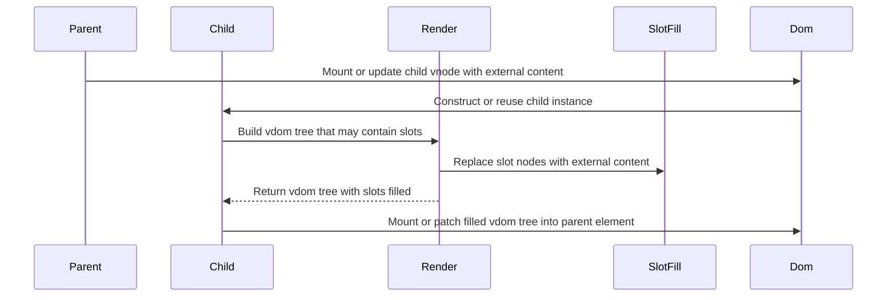

# Chapter 6: Slots and fillSlots

Imagine you’re building a reusable `Modal` component.

You want the modal to own:

- The backdrop  
- The close button  
- The layout  

…but **not** the text inside. Sometimes it should show a login form, sometimes a warning, sometimes a simple message.

How do you keep the *frame* fixed while letting the *picture* change?

- If the modal hard‑codes its body content, it’s not reusable.  
- If the parent passes a big HTML string, you lose structure and safety.  
- If the parent tries to “reach inside” the modal DOM and insert elements, you’re back to manual DOM hacking.

You need a way for the modal to say:

> “Here is *where* your content goes. I’ll control everything else.”

That’s what **slots** are: *holes* in a component where someone else’s VNodes can be dropped.

And you need something that actually takes the caller’s content and pushes it into those holes before mounting. That’s **`fillSlots`**.

This chapter is about:

- What slots are in this framework  
- How to declare them with `hSlot`  
- How `fillSlots` rewrites VNode trees to insert external content  
- How this ties into components and mounting from earlier chapters

We’ll build on:

- VNodes and types from [VNode / DOM_TYPES](01_vnode_dom_types.md)  
- `h`, `hFragment`, `hSlot` from [h / hString / hFragment / hSlot](02_h_hstring_hfragment_hslot.md)  
- Components and their `render()` from [defineComponent / Component](03_definecomponent_component.md)  
- The mounting pipeline from [mountDOM / destroyDOM / patchDOM](04_mountdom_destroydom_patchdom.md)

---

## 1. The problem: reusable layout, flexible content

Think about a `Card` component:

```js
// Desired usage
h(Card, null, [
  h('h2', null, ['Title']),
  h('p', null, ['Some body text']),
])
```

We’d like `Card` itself to control:

- The outer border and padding  
- The structure (maybe header, body, footer)  

But we want the **caller** to decide which elements go into the “body” area.

If you try to code `Card` without slots, you might end up with props like:

```js
h(Card, {
  titleText: 'Title',
  bodyText: 'Some body text',
})
```

That works only for very simple content. As soon as callers want:

- Multiple paragraphs  
- Images  
- Links  
- Nested components  

…this “string prop” approach breaks down.

We need a way to say:

- “Here is my skeleton VNode tree”  
- “At this exact spot, put whatever VNodes the caller passed as children”  

That’s what slots plus `fillSlots` give you.

---

## 2. A quick refresher: `hSlot` and `DOM_TYPES.SLOT`

In [h / hString / hFragment / hSlot](02_h_hstring_hfragment_hslot.md) you saw `hSlot` briefly:

```js
import { hSlot } from './h'

hSlot()           // simple, no default content
hSlot([/* vnodes */]) // with default content
```

Under the hood (`h.js`):

```js
let hSlotCalled = false

export function hSlot(children = []) {
  hSlotCalled = true
  return { type: DOM_TYPES.SLOT, children }
}
```

Two important things happen:

1. It returns a VNode with `type: 'slot'` and `children` holding **default content**.  
2. It flips the global `hSlotCalled` flag so components can later decide whether they need to run slot‑filling logic.

Also, in [VNode / DOM_TYPES](01_vnode_dom_types.md) we saw that `DOM_TYPES` includes:

```js
export const DOM_TYPES = {
  TEXT: 'text',
  ELEMENT: 'element',
  FRAGMENT: 'fragment',
  COMPONENT: 'component',
  SLOT: 'slot',
}
```

But notice something: **`mountDOM` never handles `DOM_TYPES.SLOT`**. If a `SLOT` node reaches the mounting layer, it throws.

That’s because slots are a **pure VNode concept**. They must be replaced with real content **before** we ever touch the DOM.

`fillSlots` is the function that does that replacement.

---

## 3. Where do slot contents live?

The framework needs two pieces to make slots useful:

1. A way for a **component** to declare where content goes → `hSlot()` inside its `render()`.
2. A way for the **parent** to provide that content → pass VNodes as the component’s `children`.

The parent side you already know from [h / hString / hFragment / hSlot](02_h_hstring_hfragment_hslot.md):

```js
// Parent render
h(Card, null, [
  h('h2', null, ['Title']),
  h('p', null, ['Body']),
])
```

On the component side, [defineComponent / Component](03_definecomponent_component.md) gives every component instance a private `#children` array:

```js
// component.js
#children = []

setExternalContent(children) {
  this.#children = children
}
```

Those `children` come from the component VNode created by `h`:

- `h(Card, null, [ ... ])` builds a `COMPONENT` VNode.
- `mountDOM` extracts that `children` array.
- It constructs a `Component` instance and calls:

  ```js
  component.setExternalContent(children)
  ```

So when `Card.render()` runs, the instance has:

- `this.props` – its own props  
- `this.state` – its own state  
- `this.#children` – the external VNodes the parent passed

The missing link is: **how do those `#children` get inserted into the right place in the render tree?**

That’s `fillSlots`’ job.

---

## 4. The component’s `render()` and the slot flag

In [defineComponent / Component](03_definecomponent_component.md), each component class wraps your `render` function with its own `render` method:

```js
// component.js
import { didCreateSlot, resetDidCreateSlot } from './h'
import { fillSlots } from './slots'

render() {
  const vdom = render.call(this)

  if (didCreateSlot()) {
    fillSlots(vdom, this.#children)
    resetDidCreateSlot()
  }

  return vdom
}
```

Let’s walk this through slowly.

1. `render.call(this)` is **your** render function, something like:

   ```js
   render() {
     return h('div', { class: 'card' }, [
       h('div', { class: 'card-body' }, [hSlot()]),
     ])
   }
   ```

   If it calls `hSlot()`, the global `hSlotCalled` flag becomes `true`.

2. After your `render()` returns, the wrapper looks at `didCreateSlot()`:
   - If no slot was created, it just returns the VNode tree as-is.  
   - If at least one slot was created, it calls `fillSlots(vdom, this.#children)`.

3. `fillSlots` walks the VNode tree and replaces all slot placeholders with:
   - The external content (`this.#children`) if there is any  
   - Or the slot’s default content (the `children` passed to `hSlot`) otherwise

4. `resetDidCreateSlot()` resets the global flag to `false` so it doesn’t leak across renders.

Analogy: your component’s `render` draws a frame with empty openings (slots). Only after that does a helper come in, see which frames have openings, and drop actual photos (external content) into them.

---

## 5. `fillSlots`: walking the VNode tree and swapping holes

Now let’s look at the actual implementation in `slots.js`:

```js
// slots.js
import { DOM_TYPES, hFragment } from './h'
import { traverseDFS } from './traverse-dom'
import { assert } from './utils/assert'

export function fillSlots(vdom, externalContent = []) {
  function processNode(node, parent, index) {
    insertViewInSlot(node, parent, index, externalContent)
  }

  traverseDFS(vdom, processNode, shouldSkipBranch)
}
```

Key ideas:

- `fillSlots` doesn’t know anything about components or DOM; it only sees the root VNode and an array of **external VNodes**.
- It uses `traverseDFS` from `traverse-dom.js` to walk the VNode tree depth‑first.
- For every node visited, it calls `processNode`, which delegates to `insertViewInSlot`.

`traverseDFS` (from [VNode / DOM_TYPES](01_vnode_dom_types.md) section 5) looks like:

```js
export function traverseDFS(
  vdom,
  processNode,
  shouldSkipBranch = () => false,
  parentNode = null,
  index = null
) {
  if (shouldSkipBranch(vdom)) return

  processNode(vdom, parentNode, index)

  if (vdom.children) {
    vdom.children.forEach((child, i) =>
      traverseDFS(child, processNode, shouldSkipBranch, vdom, i)
    )
  }
}
```

So for each node it visits, you get:

- `node` – the current VNode  
- `parentNode` – its parent VNode (or `null` at the root)  
- `index` – its position in `parentNode.children` (or `null` at the root)

`fillSlots` uses this to surgically edit `parent.children[index]` for slot nodes.

---

## 6. Replacing a single slot: `insertViewInSlot`

Still in `slots.js`:

```js
function insertViewInSlot(node, parent, index, externalContent) {
  if (node.type !== DOM_TYPES.SLOT) return

  assert(parent !== null, 'Slot nodes must have a parent')
  assert(index !== null, 'Slot nodes must have an index')

  const defaultContent = node.children
  const views =
    externalContent.length > 0 ? externalContent : defaultContent

  assert(Array.isArray(views), 'Slot views must be an array')

  const hasContent = views.length > 0
  if (hasContent) {
    parent.children.splice(index, 1, hFragment(views))
  } else {
    parent.children.splice(index, 1)
  }
}
```

Walkthrough:

1. **Ignore non‑slot nodes**

   ```js
   if (node.type !== DOM_TYPES.SLOT) return
   ```

2. **Sanity checks**

   Slots can only live **inside** something else; they cannot be the root. That’s why we assert:

   ```js
   assert(parent !== null, 'Slot nodes must have a parent')
   assert(index !== null, 'Slot nodes must have an index')
   ```

3. **Decide which content to insert**

   ```js
   const defaultContent = node.children
   const views =
     externalContent.length > 0 ? externalContent : defaultContent
   ```

   - `defaultContent` – the content given to `hSlot([...])` when the component was written.
   - `externalContent` – the VNodes passed as children from the parent (`this.#children`).
   - If the parent provided **any** external content, that wins over default.
   - If not, the component’s default content is used.

   This mimics HTML slots: “use caller content if present; otherwise, fall back to my own.”

4. **Replace the slot node in its parent**

   Two cases:

   - There is some content (`views.length > 0`)

     ```js
     parent.children.splice(index, 1, hFragment(views))
     ```

     - Remove one element (the slot) at `index`
     - Insert **one new element** at the same position: a `FRAGMENT` wrapping `views`

     Why a fragment?

     - Callers might pass **multiple** VNodes as slot content:
       ```js
       h(Card, null, [
         h('h2', null, ['Title']),
         h('p', null, ['Body']),
       ])
       ```
     - We want them all to occupy the slot position *together*.
     - Fragments are the framework’s “group of siblings, no wrapper element” (see [h / hString / hFragment / hSlot](02_h_hstring_hfragment_hslot.md) and [mountDOM / destroyDOM / patchDOM](04_mountdom_destroydom_patchdom.md)). The children’s DOM nodes go directly into the parent, but they behave as a single unit from the VNode perspective.

   - No content at all (no external, no default)

     ```js
     parent.children.splice(index, 1)
     ```

     The slot just disappears; nothing is rendered in its place.

Analogy: the parent VNode’s `children` array is like a row of picture hooks. When we find a hook that’s marked “slot,” we take it down and either:

- Hang a small collaged frame (fragment with multiple photos), or  
- Leave the wall blank if there’s nothing to show.

---

## 7. Skipping component subtrees

One last helper in `slots.js`:

```js
function shouldSkipBranch(node) {
  return node.type === DOM_TYPES.COMPONENT
}
```

This is passed into `traverseDFS`:

```js
traverseDFS(vdom, processNode, shouldSkipBranch)
```

Meaning: **do not** descend into child components when filling slots.

Why?

- Slots are **per component instance**.  
- Each component handles its own slots based on its own `this.#children`.  
- If `fillSlots` for parent A wandered into child B’s VNode tree, it might try to shove A’s external content into B’s slot placeholders, which makes no sense.

Instead, the contract is:

- Parent calls `render()` on its own component instance.  
- That instance’s `render()`:
  - Runs its own `hSlot()` calls (if any).
  - Runs its own `fillSlots(vdom, this.#children)` on **its root VNode only**.
- The traversal stops when it encounters another component node.

This keeps slot filling nicely scoped.

---

## 8. A concrete example: `RouterLink` and its slot

We’ve already met a real component that uses slots: `RouterLink` in `router-components.js`:

```js
// router-components.js
import { defineComponent } from './component'
import { h, hSlot } from './h'

export const RouterLink = defineComponent({
  render() {
    const { to } = this.props

    return h(
      'a',
      {
        href: to,
        on: {
          click: (e) => {
            e.preventDefault()
            this.appContext.router.navigateTo(to)
          },
        },
      },
      [hSlot()]
    )
  },
})
```

Usage:

```js
h(RouterLink, { to: '/home' }, ['Go home'])
```

Let’s follow the chain:

1. Parent’s `render` creates a `COMPONENT` VNode for `RouterLink` with:
   - `props: { to: '/home' }`
   - `children: ['Go home']` (later turned into a `TEXT` VNode)

2. `mountDOM` sees this component VNode, does:

   ```js
   const component = new RouterLink(props, events, hostComponent)
   component.setExternalContent(children)  // children = ['Go home' → text vnode]
   component.mount(parentEl, index)
   ```

3. Inside `RouterLink.mount`:

   ```js
   this.#vdom = this.render()
   ```

   - This calls the user render function we saw.
   - That render calls `hSlot()`, flipping `hSlotCalled` to `true`.

4. The wrapper `Component.render()` sees `didCreateSlot()` is true and calls:

   ```js
   fillSlots(vdom, this.#children)
   resetDidCreateSlot()
   ```

   At this point:

   - `vdom` has:
     - An `ELEMENT` VNode for `<a>`
     - One child: a `SLOT` VNode with no default children
   - `this.#children` is `[ TextVNode('Go home') ]`

5. `fillSlots` walks the tree, hits the `SLOT` node, and calls:

   ```js
   insertViewInSlot(
     node,           // the SLOT vnode
     parent,         // the <a> vnode
     index,          // usually 0
     externalContent // [TextVNode('Go home')]
   )
   ```

   That ends up doing:

   ```js
   parent.children.splice(index, 1, hFragment(views))
   ```

   So the `<a>`’s children become:

   ```js
   [
     {
       type: 'fragment',
       children: [ TextVNode('Go home') ]
     }
   ]
   ```

6. After that, `mountDOM` runs on this updated VNode tree:

   - It mounts the `<a>` element.  
   - It mounts the fragment child, which just mounts the text node inside the `<a>`.  

Resulting DOM:

```html
<a href="/home">Go home</a>
```

`RouterLink` fully controls:

- The `<a>` tag  
- The routing logic on click  

The caller fully controls:

- The link label (text or any nested content)

This is exactly the picture frame analogy: you choose the frame, the user chooses the picture.

---

## 9. One render cycle with slots: who does what?

To see slots in context, let’s put the pieces together in a small sequence diagram.

Participants:

- `Parent` – any component that uses a slotted child  
- `Child` – the component that declares a slot in its render  
- `Render` – the child’s wrapped `render()` method  
- `SlotFill` – the `fillSlots` helper  
- `Dom` – the DOM mounting logic (`mountDOM` and friends)



Relating this to earlier chapters:

- `Dom` is driven by [mountDOM / destroyDOM / patchDOM](04_mountdom_destroydom_patchdom.md).  
- `Render` is the wrapper method in [defineComponent / Component](03_definecomponent_component.md).  
- `SlotFill` is `fillSlots` from this chapter.  
- `Parent` and `Child` are VNode‑based components built with `h` from [h / hString / hFragment / hSlot](02_h_hstring_hfragment_hslot.md).

---

## 10. Patterns you can build with slots

With just “one unnamed slot” you can already do a lot:

### 10.1 Control outer skeleton, let callers fill content

The classic `Card`:

```js
import { defineComponent } from './component'
import { h, hSlot } from './h'

export const Card = defineComponent({
  render() {
    return h('div', { class: 'card' }, [
      h('div', { class: 'card-body' }, [hSlot()]),
    ])
  },
})
```

Usage:

```js
h(Card, null, [
  h('h2', null, ['Profile']),
  h('p', null, ['User details go here']),
])
```

The `Card` knows nothing about what “user details” are. It just carves out a space.

### 10.2 Provide fallback content when nothing is passed

Slots can have default content:

```js
// Inside component render
h('div', null, [
  hSlot([ h('p', null, ['No data available']) ]),
])
```

- If parent passes children → those replace the slot.  
- If parent passes nothing → the `<p>No data available</p>` is rendered.

### 10.3 Compose components without extra wrappers

Because `fillSlots` always wraps inserted content in a fragment, you can pass multiple siblings without extra `<div>`s:

```js
h(Card, null, [
  h('h3', null, ['Title']),
  h('ul', null, [
// ...
  ]),
])
```

From the DOM’s point of view, these siblings go straight under the `card-body` element, no extra wrapper.

That plays nicely with the fragment behavior you saw in [h / hString / hFragment / hSlot](02_h_hstring_hfragment_hslot.md) and [mountDOM / destroyDOM / patchDOM](04_mountdom_destroydom_patchdom.md).

---

## 11. Things slots deliberately do *not* do

You might notice some things are missing:

- Multiple named slots (`header`, `footer`, etc.)  
- Scoped slots (passing data from child to slot content)  

This framework intentionally keeps slots **simple**:

- One unnamed slot area per component render tree (though you could call `hSlot` multiple times and share the same `externalContent`).  
- No “slot props” – if you need to pass data back up, you use component events from [Dispatcher and component events (emit)](05_dispatcher_and_component_events_emit.md).

You still get a lot of compositional power with this minimalist design, especially combined with:

- Fragments for multiple roots  
- Component events for child–parent communication  
- The router components that already use slots for link labels, as in [HashRouter / RouterLink / RouterOutlet](07_hashrouter_routerlink_routeroutlet.md)

---

## 12. Recap

Slots in this framework are like **cutouts in a cardboard template**:

- The component’s render function draws the template and calls `hSlot()` where it expects outside content.  
- `hSlot()` creates a `SLOT` VNode and flips a flag to say “some slot exists in this render.”  
- The component wrapper `render` checks that flag, then runs `fillSlots` with:
  - the component’s VNode tree  
  - the external VNodes passed from the parent as `children`  

`fillSlots`:

- Uses `traverseDFS` to walk the VNode tree, skipping component subtrees.  
- Finds `SLOT` nodes and replaces them:
  - With external content if present  
  - Otherwise with default content from the slot’s own `children`  
- Always wraps the inserted content in a fragment so multiple VNodes can live in one slot location.

After that transformation, the VNode tree contains only:

- `TEXT`, `ELEMENT`, `FRAGMENT`, and `COMPONENT` nodes  

…and is safe to feed into `mountDOM` and `patchDOM` from [mountDOM / destroyDOM / patchDOM](04_mountdom_destroydom_patchdom.md).

Slots give you *layout ownership* without *content ownership*: components define frames, parents pick pictures.

---

Now that components can both **talk** to parents via events ([Dispatcher and component events (emit)](05_dispatcher_and_component_events_emit.md)) and **accept content** from parents via slots, the next question is: how do you stitch many components into a real application with pages and navigation?

In the next chapter, [HashRouter / RouterLink / RouterOutlet](07_hashrouter_routerlink_routeroutlet.md), you’ll see how routing uses all the concepts you’ve learned—components, events, slots, and the dispatcher—to render different components based on the URL and keep your UI in sync with browser navigation.