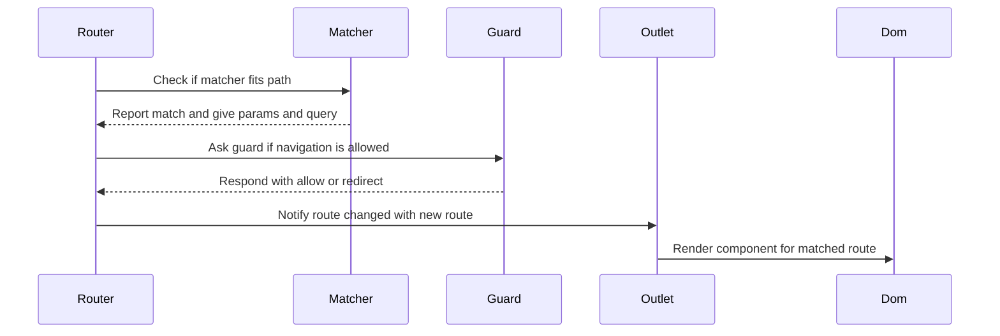

# Chapter 8: RouteMatcher / validateRoute

You type `/users/42?tab=posts` into the address bar of your single‑page app, hit Enter, and:

- The URL changes  
- A user profile screen appears  
- The “Posts” tab is active  

No page reload. No full server round‑trip.

Somehow, your router:

- Recognized that `/users/42` means “show the User page”  
- Extracted `42` as a `userId`  
- Saw `?tab=posts` and turned it into `{ tab: 'posts' }`  
- Knew this route was valid and safe to use  

This chapter is about the small but crucial piece that does that pattern matching and validation: **route matchers** and `validateRoute`.

Think of route matchers as **stencils** for URLs:

- The stencil says “I match `/users/:userId`”  
- When you hold it over a URL like `/users/42?tab=posts`, it can say:
  - “Yes, that fits me”
  - “Here is the `userId` I found: `42`”
  - “Here is the query: `{ tab: 'posts' }`”

We’ll connect this to the `HashRouter` you saw in [HashRouter / RouterLink / RouterOutlet](07_hashrouter_routerlink_routeroutlet.md), since that class uses these matchers all the time.

---

## 1. Why we need route matchers at all

Back in [HashRouter / RouterLink / RouterOutlet](07_hashrouter_routerlink_routeroutlet.md) you saw that `HashRouter` is constructed with a list of routes:

```js
const routes = [
  { path: '/', component: Home },
  { path: '/users/:userId', component: User },
  { path: '*', component: NotFound },
]
```

Now imagine you are the router and someone calls:

```js
router.navigateTo('/users/42?tab=posts')
```

You must:

1. Decide which route definition matches this string.  
2. Extract any **path params** (like `:userId`) from it.  
3. Extract any **query params** from the part after `?`.  
4. Handle special cases:
   - Catch‑all routes like `*`  
   - Redirect routes like `{ path: '/old', redirect: '/new' }`  
5. Make sure route definitions themselves are **valid** and won’t blow up later.

You could do this with ad‑hoc `if` checks and `split('/')` calls all over the router, but that quickly becomes brittle. Instead, this codebase uses **RouteMatcher objects**:

- Each route definition is turned into one RouteMatcher  
- The matcher knows:
  - How to test a path  
  - How to pull out params  
  - How to pull out query  

The router just loops over matchers and asks each:

- “Do you match this path?”  
- “If so, please give me params and query.”

Before any matcher is built, `validateRoute` checks the route definition to catch mistakes early—like a path that doesn’t start with `/` or a redirect that loops to itself.

---

## 2. Route and RouteMatcher: the shapes

All the routing‑specific logic lives in `route-matchers.js`. Let’s start by looking at the types described in the comments.

A **Route** is what you write in your route table:

```js
/**
 * @typedef Route
 * @type {object}
 * @property {string} path - The path of the route.
 * @property {import('./component').Component} component - The component to render when the route is matched.
 * @property {string} [redirect] - The path to redirect to when the route is matched.
 * @property {(from: string, to: string) => Promise<boolean|string>} [beforeEnter] - Guard before navigation.
 */
```

Fields:

- `path` – pattern for the path piece of the URL hash:
  - `/`  
  - `/users/:userId`  
  - `/users/:userId/posts/:postId`  
  - `*` (catch‑all)  
- `component` – which component to render for this route.  
- `redirect` – optional; if present, this route is not rendered, it redirects.  
- `beforeEnter` – optional async guard the router calls to decide if navigation is allowed; you saw how the router uses this in [HashRouter / RouterLink / RouterOutlet](07_hashrouter_routerlink_routeroutlet.md).

A **RouteMatcher** wraps a Route with logic:

```js
/**
 * @typedef RouteMatcher
 * @type {object}
 * @property {Route} route - The route that this matcher matches.
 * @property {boolean} isRedirect - Whether the route is a redirect.
 * @property {(path: string) => boolean} checkMatch - Check if this matcher matches a path.
 * @property {(path: string) => Object<string, string>} extractParams - Extract path parameters.
 * @property {(path: string) => Object<string, string>} extractQuery - Extract query parameters.
 */
```

So a matcher works like this:

- You call `matcher.checkMatch('/users/42?tab=posts')` → `true` or `false`.  
- If it’s `true`, you call:
  - `matcher.extractParams('/users/42?tab=posts')` → `{ userId: '42' }`  
  - `matcher.extractQuery('/users/42?tab=posts')` → `{ tab: 'posts' }`  
- The router uses `matcher.route` to know which `component`, `redirect`, and `beforeEnter` to use.

Think of `Route` as “human‑friendly description of a route” and `RouteMatcher` as “machine‑ready helper for that route.”

---

## 3. `validateRoute`: catching bad routes early

Before any matcher gets created, each `Route` is run through `validateRoute`. This is like a **lint check** for route definitions.

Here’s the function, kept short:

```js
const CATCH_ALL_ROUTE = '*'

export function validateRoute(route) {
  if (typeof route.path !== 'string') {
    throw new Error('Route path must be a string')
  }

  if (isNotBlankOrEmptyString(route.path) === false) {
    throw new Error('Route path must not be empty')
  }

  if (route.path[0] !== '/' && route.path !== CATCH_ALL_ROUTE) {
    throw new Error(
      'Route path must start with a "/" or be the catch-all route "*"'
    )
  }

  if (route.redirect && route.path === route.redirect) {
    throw new Error("A redirect route can't redirect to itself")
  }
}
```

Let’s go line by line.

### 3.1 Path must be a string

```js
if (typeof route.path !== 'string') {
  throw new Error('Route path must be a string')
}
```

Guards against accidental `path: 123` or `path: null`.

### 3.2 Path must not be blank

```js
if (isNotBlankOrEmptyString(route.path) === false) {
  throw new Error('Route path must not be empty')
}
```

`isNotBlankOrEmptyString` comes from `utils/strings.js`:

- It ensures the path is not `''` or `'   '`.  

So `path: ''` is rejected.

### 3.3 Path must start with `/` or be `*`

```js
if (route.path[0] !== '/' && route.path !== CATCH_ALL_ROUTE) {
  throw new Error(
    'Route path must start with a "/" or be the catch-all route "*"'
  )
}
```

Valid paths:

- `/`  
- `/users`  
- `/users/:id`  
- `*`  

Invalid:

- `'users'` (no leading slash)  
- `'/*/user'` (first char is not `/` or `*` literal)

This constraint simplifies the regex logic and makes your routes visually consistent.

### 3.4 Redirect routes cannot redirect to themselves

```js
if (route.redirect && route.path === route.redirect) {
  throw new Error("A redirect route can't redirect to itself")
}
```

If you wrote:

```js
{ path: '/login', redirect: '/login' }
```

that would create an infinite redirect loop. `validateRoute` stops that before it ever hits runtime.

### 3.5 Where `validateRoute` is used

Every matcher is created with:

```js
export function makeRouteMatcher(route) {
  validateRoute(route)

  return routeHasParams(route)
    ? makeMatcherWithParams(route)
    : makeMatcherWithoutParams(route)
}
```

So:

- Your routes are validated **once** at router creation time.  
- If there’s a bad route definition, you get an immediate error when you construct the router, instead of subtle bugs later.

Analogy: `validateRoute` is the bouncer at the club entrance—bad routes never get inside.

---

## 4. `makeRouteMatcher`: turning a route into a matcher

`makeRouteMatcher` is the main factory:

```js
export function makeRouteMatcher(route) {
  validateRoute(route)

  return routeHasParams(route)
    ? makeMatcherWithParams(route)
    : makeMatcherWithoutParams(route)
}

function routeHasParams({ path }) {
  return path.includes(':')
}
```

It divides routes into two kinds:

1. **With params**, like `/users/:userId` or `/users/:userId/posts/:postId`  
2. **Without params**, like `/`, `/about`, and `*`  

Why distinguish them?

- Param routes need a **capturing regex** to pull out `userId`, `postId`, etc.  
- Param‑less routes can often be matched faster and have no `params`, so they can always just return `{}`.

Let’s see both variants.

---

## 5. Matchers **with** params: `/users/:userId`

Routes with `:` placeholders are turned into regexes with **named capture groups**.

### 5.1 Building the matcher

```js
function makeMatcherWithParams(route) {
  const regex = makeRouteWithParamsRegex(route)
  const isRedirect = typeof route.redirect === 'string'

  return {
    route,
    isRedirect,
    checkMatch(path) {
      return regex.test(path)
    },
    extractParams(path) {
      const { groups } = regex.exec(path)
      return groups
    },
    extractQuery,
  }
}
```

This object is your RouteMatcher:

- `route` – the original `Route` object.  
- `isRedirect` – convenience flag, so the router can quickly see if it should call `navigateTo(route.redirect)` instead of rendering a component.  
- `checkMatch(path)` – test the regex against the incoming path string.  
- `extractParams(path)` – run the regex again, and read its `.groups`.  
- `extractQuery(path)` – shared helper function we’ll inspect in a bit.

The interesting part is how `regex` is built.

### 5.2 Converting a param path into a regex

```js
function makeRouteWithParamsRegex({ path }) {
  const regex = path.replace(
    /:([^/]+)/g,
    (_, paramName) => `(?<${paramName}>[^/]+)`
  )

  return new RegExp(`^${regex}$`)
}
```

This packs a lot into a few lines; let’s unpack:

1. `/:([^/]+)/g` matches:
   - A literal `:`  
   - Followed by any run of characters that is not `/`  
   - Captures that name into `paramName`  

   Examples:
   - `/users/:userId` → it finds `:userId` and captures `userId`  
   - `/users/:userId/posts/:postId` → it finds both `:userId` and `:postId`

2. The `replace` callback:

   ```js
   (_, paramName) => `(?<${paramName}>[^/]+)`
   ```

   - `_` is the whole match (`:userId`), which we ignore.  
   - `paramName` is the captured name (`userId`).  
   - The replacement string `(?<userId>[^/]+)` is a **named capture group**:
     - `(?<userId> ... )` means “capture this as `groups.userId`”
     - `[^/]+` means “one or more non‑slash characters”

   So:

   - `'/users/:userId'` becomes `'/users/(?<userId>[^/]+)'`  
   - `'/users/:userId/posts/:postId'` becomes `'/users/(?<userId>[^/]+)/posts/(?<postId>[^/]+)'`

3. Finally, wrap the whole thing with `^` and `$`:

   ```js
   new RegExp(`^${regex}$`)
   ```

   This ensures:
   - `^` – beginning of string  
   - `$` – end of string  

   So the regex will match the entire path portion (it can still contain `?query` afterward; we’ll see that nuance when extracting params vs query).

### 5.3 Using the regex

Once we have that `regex`, `checkMatch` and `extractParams` are straightforward:

```js
checkMatch(path) {
  return regex.test(path)
}
```

- `regex.test('/users/42')` → `true`  
- `regex.test('/users')` → `false`  
- `regex.test('/users/42?tab=posts')`:
  - The pattern `[^/]+` **does not** include `?`, so by default the regex matches only the piece before `?`.
  - That means `checkMatch('/users/42?tab=posts')` will still return `true` for `/users/:userId` style paths.

And for params:

```js
extractParams(path) {
  const { groups } = regex.exec(path)
  return groups
}
```

If the regex matches, `regex.exec(path)` returns an object like:

```js
{
  0: '/users/42',
  groups: { userId: '42' },
  // ...
}
```

So `groups` becomes the `params` object.

In practice, the router calls:

```js
this.#params = matcher.extractParams(path)
```

and components later read `this.appContext.router.params` (as described in [HashRouter / RouterLink / RouterOutlet](07_hashrouter_routerlink_routeroutlet.md)).

Analogy: for param routes, the matcher is a stencil that both checks the outline and also has labels for each cut‑out (“this slot is userId, that slot is postId”).

---

## 6. Matchers **without** params: `/`, `/about`, `*`

Routes without `:` are simpler: there’s nothing to extract into params, only a yes/no match.

### 6.1 Building the matcher

```js
function makeMatcherWithoutParams(route) {
  const regex = makeRouteWithoutParamsRegex(route)
  const isRedirect = typeof route.redirect === 'string'

  return {
    route,
    isRedirect,
    checkMatch(path) {
      return regex.test(path)
    },
    extractParams() {
      return {}
    },
    extractQuery,
  }
}
```

Differences from the param‑based matcher:

- `extractParams` always returns an empty object.  
- The regex generation is a bit different; it must handle the catch‑all `*`.

### 6.2 Building regex for non‑param routes

```js
function makeRouteWithoutParamsRegex({ path }) {
  if (path === CATCH_ALL_ROUTE) {
    return new RegExp('^.*$')
  }

  return new RegExp(`^${path}$`)
}
```

Two cases:

1. `path === '*'`:

   ```js
   new RegExp('^.*$')
   ```

   This matches **any** string, so it’s the fallback route (“404” route).

2. Any other path:

   ```js
   new RegExp(`^${path}$`)
   ```

   So:

   - `/` → `/^\/$/`  
   - `/about` → `/^\/about$/`  

   Again, these match the path including optional `?query` bits, but only at the string level. Query extraction is handled separately.

This simple approach has one important implication: if you have `*` at the end of your routes array, it will match anything that all previous routes did not match. That’s how you implement “404 not found”.

---

## 7. Extracting query strings: `?search=abc&foo=bar`

Route matchers share a helper for queries:

```js
function extractQuery(path) {
  const queryIndex = path.indexOf('?')

  if (queryIndex === -1) {
    return {}
  }

  const search = new URLSearchParams(path.slice(queryIndex + 1))

  return Object.fromEntries(search.entries())
}
```

Step by step:

1. Find the index of `?`:

   ```js
   const queryIndex = path.indexOf('?')
   ```

   - If no `?`, there is no query: return `{}`.

2. Slice off everything after `?`:

   ```js
   const search = new URLSearchParams(path.slice(queryIndex + 1))
   ```

   For `/users/42?tab=posts&sort=asc`, `path.slice(queryIndex + 1)` yields `tab=posts&sort=asc`.

3. Use `URLSearchParams` to parse it:

   ```js
   const search = new URLSearchParams('tab=posts&sort=asc')
   ```

4. Turn it into a plain object:

   ```js
   return Object.fromEntries(search.entries())
   ```

   Result:

   ```js
   { tab: 'posts', sort: 'asc' }
   ```

The router uses this in `navigateTo`:

```js
this.#query = matcher.extractQuery(path)
```

Then components can access it via `this.appContext.router.query`.

Analogy: think of `extractQuery` as a little machine that takes the “note stuck after the question mark” and reads it into a tidy dictionary.

---

## 8. How the router uses RouteMatchers

`HashRouter` (from [HashRouter / RouterLink / RouterOutlet](07_hashrouter_routerlink_routeroutlet.md)) wires all this together.

### 8.1 Creating matchers from routes

In `router.js`, the constructor does:

```js
import { makeRouteMatcher } from './route-matchers'
import { assert } from './utils/assert'

export class HashRouter {
  #matchers = []

  constructor(routes = []) {
    assert(Array.isArray(routes), 'Routes must be an array')
    this.#matchers = routes.map(makeRouteMatcher)
  }

  // ...
}
```

For each route in your config:

1. `makeRouteMatcher(route)`:
   - Calls `validateRoute(route)`  
   - Returns either a param‑matcher or a non‑param matcher.  

2. `this.#matchers` becomes the full list.

Later, `navigateTo(path)` uses these matchers:

```js
async navigateTo(path) {
  const matcher = this.#matchers.find((matcher) =>
    matcher.checkMatch(path)
  )

  if (matcher == null) {
    console.warn(`[Router] No route matches path "${path}"`)

    this.#matchedRoute = null
    this.#params = {}
    this.#query = {}

    return
  }

  if (matcher.isRedirect) {
    return this.navigateTo(matcher.route.redirect)
  }

  const from = this.#matchedRoute
  const to = matcher.route
  const { shouldNavigate, shouldRedirect, redirectPath } =
    await this.#canChangeRoute(from, to)

  if (shouldRedirect) {
    return this.navigateTo(redirectPath)
  }

  if (shouldNavigate) {
    this.#matchedRoute = matcher.route
    this.#params = matcher.extractParams(path)
    this.#query = matcher.extractQuery(path)
    this.#pushState(path)

    this.#dispatcher.dispatch(ROUTER_EVENT, { from, to, router: this })
  }
}
```

Key interactions with the matcher:

- `find((matcher) => matcher.checkMatch(path))` chooses which route applies.  
- `matcher.isRedirect` decides whether this is a redirect‑only route.  
- `matcher.extractParams(path)` fills `router.params`.  
- `matcher.extractQuery(path)` fills `router.query`.

Everything else in `navigateTo` is about guards, history, and notifications, covered already in [HashRouter / RouterLink / RouterOutlet](07_hashrouter_routerlink_routeroutlet.md).

You can now see how clean this keeps the router: all the “does this path fit this route?” logic lives in matchers, not sprinkled through the router.

---

## 9. One navigation, step by step

Let’s walk through a full navigation with the new knowledge, using the same actors as before plus the matcher.

Participants:

- `Router` – the `HashRouter` instance  
- `Matcher` – the matching RouteMatcher  
- `RouteGuard` – the `beforeEnter` guard, if any  
- `Outlet` – `RouterOutlet` component  
- `DOM` – the DOM engine (`mountDOM` / `patchDOM`)  



In words:

1. `Router.navigateTo('/users/42?tab=posts')` is called, either by `RouterLink` or `popstate`.  
2. The router loops over `this.#matchers` until one `checkMatch` returns `true`.  
3. With the chosen matcher:
   - `extractParams` returns `{ userId: '42' }`  
   - `extractQuery` returns `{ tab: 'posts' }`  
4. If there is a `beforeEnter`, it’s invoked; it may allow navigation, block it, or request a redirect.  
5. If allowed:
   - Router updates `matchedRoute`, `params`, `query`  
   - Pushes the new hash into history  
   - Dispatches a route change event via its internal `Dispatcher`  
6. `RouterOutlet`, which subscribed earlier, receives `{ from, to, router }`, updates its state, and `render()` returns the new route’s `component`.  
7. The component system runs `patchDOM` to update the visible UI.

At the heart of that chain, the RouteMatcher provided the “does this path fit?” and “what are the named pieces?” logic.

---

## 10. Practical examples and small gotchas

Now that you know how matchers and validation work, here are a few concrete patterns and edge cases.

### 10.1 Simple static routes

```js
const routes = [
  { path: '/', component: Home },
  { path: '/about', component: About },
]
```

- Both are “no‑param” routes → `makeMatcherWithoutParams`.  
- `extractParams` always gives `{}`.  
- `extractQuery` still works, so `/about?foo=bar` sets `router.query` to `{ foo: 'bar' }`.

### 10.2 One param route

```js
{ path: '/users/:userId', component: User }
```

For `/users/42?tab=posts`:

- Matcher regex is something like `/^\/users\/(?<userId>[^/]+)$/`  
- `extractParams` gives `{ userId: '42' }`  
- `extractQuery` gives `{ tab: 'posts' }`  

Inside `User`, you’d read:

```js
const { userId } = this.appContext.router.params
const { tab } = this.appContext.router.query
```

### 10.3 Multiple params

```js
{ path: '/users/:userId/posts/:postId', component: Post }
```

For `/users/42/posts/99`:

- Params become `{ userId: '42', postId: '99' }`.

### 10.4 Catch‑all 404 route

```js
{ path: '*', component: NotFound }
```

Placed at the end of your routes array:

```js
const routes = [
  { path: '/', component: Home },
  { path: '/users/:userId', component: User },
  { path: '*', component: NotFound },
]
```

Any path that fails to match `/` or `/users/:userId` will match `*` and show `NotFound`.

### 10.5 Redirect routes

```js
{ path: '/old-users', redirect: '/users' }
```

- `validateRoute` ensures redirect path is not the same as `path`.  
- RouteMatcher sets `isRedirect: true`.  
- In `navigateTo('/old-users')`:
  - `matcher.isRedirect` is `true`, so the router calls `navigateTo('/users')` immediately.  
  - That second call matches the real `/users` route, sets `matchedRoute` and so on.

You can use this to create nice “legacy URL” redirects.

---

## 11. How this chapter connects to others

RouteMatchers and `validateRoute` sit at the boundary between URL strings and your component tree:

- They are used by `HashRouter` from [HashRouter / RouterLink / RouterOutlet](07_hashrouter_routerlink_routeroutlet.md) to decide which component to render and what values to put into `router.params` and `router.query`.  
- The route’s `beforeEnter` guard, validated by `validateRoute`, plugs into the router’s navigation logic.  
- Once a route is matched, your components are just regular components built with [defineComponent / Component](03_definecomponent_component.md), mounted and patched using [mountDOM / destroyDOM / patchDOM](04_mountdom_destroydom_patchdom.md), and free to use slots and events as in [Slots and fillSlots](06_slots_and_fillslots.md) and [Dispatcher and component events (emit)](05_dispatcher_and_component_events_emit.md).

You can think of RouteMatchers as the **address decoder** for your app: they translate “what’s in the address bar” into “which component should be on the screen and with which parameters?”

---

## 12. Recap and what’s next

In this chapter you learned:

- How `Route` objects describe routes with `path`, `component`, `redirect`, and `beforeEnter`.  
- How `validateRoute` enforces sensible route definitions:
  - Paths are non‑empty strings  
  - They start with `/` or are `*`  
  - Redirects don’t loop back to themselves  
- How `makeRouteMatcher` converts routes into:
  - Param‑based matchers using named regex groups  
  - Simple matchers for static and `*` paths  
- How each matcher exposes:
  - `checkMatch(path)` – do I fit this path?  
  - `extractParams(path)` – what are the `:param` values?  
  - `extractQuery(path)` – what are the query parameters?  
- How `HashRouter` uses those matchers in its `navigateTo` flow to keep `matchedRoute`, `params`, and `query` in sync with the URL.

Now that routing, events, slots, and DOM diffing are all in place, there’s one more invisible piece you’ve already bumped into: the **scheduler**.

Whenever components mount, unmount, or lifecycle hooks run, the framework doesn’t call everything immediately; it batches work for the “next tick” using a microtask queue. In the next chapter, [Scheduler / nextTick](09_scheduler_nexttick.md), you’ll see how that tiny job queue works, and how to use `nextTick` to wait for DOM updates before measuring or testing.