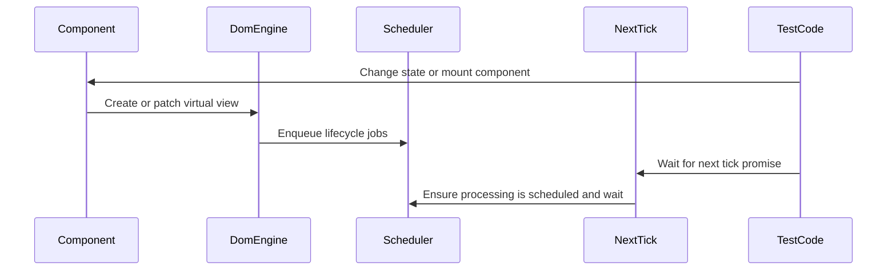

# Chapter 9: Scheduler / nextTick

You click a button that mounts a component. That component’s `onMounted` hook sets up a timer. Another component’s `onUnmounted` cleans up a subscription. The router changes routes and several components unmount in a row.

What order do all those things run in?

- Do `onMounted` hooks fire **during** DOM creation?
- What if a hook is `async` and returns a promise?
- If you want to wait until **all** those hooks have run and the DOM is stable, what do you `await`?

If every part of the framework ran “right now” in random places, you’d get:

- Hard‑to‑predict timing  
- Hooks running before elements exist  
- Tests that sometimes pass and sometimes fail, depending on micro‑scheduling  

Instead, this framework has a tiny **scheduler**:

- Any part of the codebase can **enqueue a job** with `enqueueJob(job)`.
- The scheduler batches jobs and runs them in a **microtask**.
- `nextTick()` gives you a **promise** that resolves after those jobs have been *started*, so you can wait until “the tray has been picked up.”

Think of it like a **task tray by your desk**:

- Whenever something important needs doing “soon but not right this instant,” you drop a note in the tray.  
- The office assistant comes by every few minutes, grabs any notes in the tray, and works through them.  
- If you want to wait until the assistant has picked up what’s currently in the tray, you wait for the next pickup. That’s `nextTick()`.

We’ll connect this to:

- Component mounting and unmounting from [defineComponent / Component](03_definecomponent_component.md)  
- DOM creation and teardown in [mountDOM / destroyDOM / patchDOM](04_mountdom_destroydom_patchdom.md)  
- The way `createApp` boots everything up in [createApp / Application context](10_createapp_application_context.md)

---

## 1. Why scheduling matters in a tiny framework

Walk through one simple interaction:

1. A component mounts.  
2. Its render output is turned into DOM with `mountDOM`.  
3. `mountDOM` schedules the component’s `onMounted` lifecycle hook.  
4. The router changes routes and components unmount.  
5. `destroyDOM` schedules their `onUnmounted` hooks.

Now imagine:

- Hooks ran **inline** during DOM operations.  
- One `onMounted` hook changed state immediately.  
- That re‑rendered the component **while** `mountDOM` was still walking children.

You’d have a re‑entrant mess: nested renders, patching old VNodes that haven’t even been fully mounted yet, DOM in half‑built states.

By pushing hooks into a **job queue** and processing that queue **after** the current DOM work is done, the framework guarantees:

- `mountDOM` and `destroyDOM` can finish cleanly before hooks run.  
- All hooks see a **consistent** view of the VNode tree and DOM.  
- Multiple jobs get batched into a single microtask instead of scheduling a thousand separate turns.

That’s what `scheduler.js` implements.

---

## 2. The scheduler in one glance

Here’s the whole file, split into digestible pieces:

```js
let isScheduled = false
const jobs = []
```

Two module‑level variables:

- `jobs` – the tray of pending work; an array of functions to run.  
- `isScheduled` – a flag saying “is there already a pickup scheduled?”

The public API is tiny:

```js
export function enqueueJob(job) {
  jobs.push(job)
  scheduleUpdate()
}
```

And:

```js
export function nextTick() {
  scheduleUpdate()
  return flushPromises()
}
```

Per analogy:

- `enqueueJob(job)` → “Drop a note in the tray; call the assistant if they’re not already on the way.”  
- `nextTick()` → “Make sure the next pickup is scheduled, then wait until that pickup and related microtasks are done.”

We’ll walk through:

1. How jobs are scheduled and processed.  
2. How errors inside jobs are handled.  
3. How `nextTick` and `flushPromises` let you wait for a full cycle.

---

## 3. Enqueuing and scheduling jobs

First, adding a job:

```js
export function enqueueJob(job) {
  jobs.push(job)
  scheduleUpdate()
}
```

- `job` is just a function. It can be sync or async.
- The scheduler doesn’t call it immediately; it just pushes it into `jobs`.
- Then it asks `scheduleUpdate()` to ensure there’s a microtask planned.

`scheduleUpdate` is the “only once” guard:

```js
function scheduleUpdate() {
  if (isScheduled) return

  isScheduled = true
  queueMicrotask(processJobs)
}
```

Key points:

- If we already scheduled a run (`isScheduled === true`), do nothing.  
  - This is what makes batching work: 10 calls to `enqueueJob` within the same microtask only create **one** scheduled `processJobs()`.
- If not scheduled yet:
  - Flip `isScheduled` to `true`.
  - Use `queueMicrotask(processJobs)` to ask the browser: “After the current stack and microtasks, please call `processJobs`.”

If you haven’t used `queueMicrotask` before: it’s like `Promise.resolve().then(...)`, but more explicit. It runs before any `setTimeout` (macro tasks), which is what we want: jobs are processed **soon**, but *after* the current code finishes.

So the timeline for a few quick calls like:

```js
enqueueJob(jobA)
enqueueJob(jobB)
enqueueJob(jobC)
```

looks like:

- Now: all three jobs are added to `jobs`. `scheduleUpdate` only schedules `processJobs` **once**.  
- At the next microtask: `processJobs` runs and drains the queue.

---

## 4. Running jobs safely: `processJobs`

The “assistant” who empties the tray is `processJobs`:

```js
function processJobs() {
  while (jobs.length > 0) {
    const job = jobs.shift()
    const result = job()

    Promise.resolve(result).then(
      () => {
        // Job completed successfully
      },
      (error) => {
        console.error(`[scheduler]: ${error}`)
      }
    )
  }

  isScheduled = false
}
```

Line by line:

1. `while (jobs.length > 0)`  
   - Keep going until the tray is empty.
   - If a job enqueues **new** jobs synchronously (`enqueueJob` inside `job()`), those will be pushed onto `jobs` and processed in this same loop.

2. `const job = jobs.shift()`  
   - Take the first job off the queue.

3. `const result = job()`  
   - Run the job.
   - The job can:
     - Return nothing / a plain value (sync).
     - Return a promise (async `onMounted` or `onUnmounted`).

4. `Promise.resolve(result).then(..., ...)`  
   - Wrap whatever the job returned into a promise:
     - If it’s already a promise, we just tap into it.  
     - If it’s a value (including `undefined`), this creates a resolved promise.
   - Attach:
     - A success handler (no‑op here).
     - An error handler that logs any rejection:

       ```js
       (error) => {
         console.error(`[scheduler]: ${error}`)
       }
       ```

   So if your async `onMounted` throws or rejects, you see a clear `[scheduler]` error instead of a silent failure.

5. After all jobs have been run (and their promises chained), the scheduler resets:

   ```js
   isScheduled = false
   ```

   This allows a **new** scheduling cycle to be set up by future `enqueueJob` calls.

Analogy: the assistant:

- Picks up every note currently in the tray.  
- Starts each task; if it’s a long job, they start it and make sure any error is reported.  
- When the tray is empty, they flip the “I’m on the way” sign off so the next person to add a note can call them again.

---

## 5. How the framework uses `enqueueJob`

You’ve already seen `enqueueJob` show up indirectly in previous chapters.

### 5.1 Component `onMounted` hooks

In [mountDOM / destroyDOM / patchDOM](04_mountdom_destroydom_patchdom.md), when the framework mounts a component VNode, it does:

```js
case DOM_TYPES.COMPONENT: {
  createComponentNode(vdom, parentEl, index, hostComponent)
  enqueueJob(() => vdom.component.onMounted())
  break
}
```

Sequence:

1. `createComponentNode`:
   - Instantiates the component (from [defineComponent / Component](03_definecomponent_component.md)).
   - Calls `component.mount(parentEl, index)`, which:
     - Calls `component.render()`
     - Mounts the VNode tree via `mountDOM`
     - Wires event handlers.

2. After this is done, `enqueueJob(() => vdom.component.onMounted())` adds a job:
   - The job will call `component.onMounted()`.
   - Remember in `component.js`, `onMounted` wraps the user hook in a promise:

     ```js
     onMounted() {
       return Promise.resolve(onMounted.call(this))
     }
     ```

   - So even if the user’s `onMounted` is `async` or returns a promise, the scheduler will see that and chain error logging properly.

Important: the hook runs **after** mounting is complete and **after** the current tick. This avoids re‑rendering or DOM mutations while the component subtree is still being created.

### 5.2 Component `onUnmounted` hooks

In [mountDOM / destroyDOM / patchDOM](04_mountdom_destroydom_patchdom.md), `destroyDOM` uses the scheduler for unmount hooks:

```js
case DOM_TYPES.COMPONENT: {
  vdom.component.unmount()
  enqueueJob(() => vdom.component.onUnmounted())
  break
}
```

- First, `component.unmount()`:
  - Calls `destroyDOM` on the component’s inner VNode tree.
  - Unsubscribes any dispatcher subscriptions (the event wiring you saw in [Dispatcher and component events (emit)](05_dispatcher_and_component_events_emit.md)).
- Then, enqueue a job to run `onUnmounted` asynchronously, using the same `Promise.resolve` wrapper as `onMounted`.

Again, we get a clean order:

- All DOM and subscription teardown happens **synchronously** during `destroyDOM`.  
- The user’s clean‑up logic runs later via the scheduler, so it can safely assume the component is fully unmounted.

---

## 6. Waiting for the tray: `nextTick`

So far, everything we’ve talked about happens behind the scenes. You don’t usually call `enqueueJob` yourself; the framework uses it for lifecycle and possibly other internal work.

But sometimes **you** need to wait for:

- Lifecycle hooks to be scheduled and at least *begun*.
- DOM changes that depend on those hooks to be visible (for example, in tests).
- Any scheduled jobs from a previous action to have been picked up.

That’s what `nextTick` is for:

```js
export function nextTick() {
  scheduleUpdate()
  return flushPromises()
}
```

Two steps:

1. `scheduleUpdate()` – ensure that we have at least one scheduled `processJobs` microtask.
   - If there were already jobs in the queue from `enqueueJob`, this ensures we don’t forget to process them.
   - If no jobs yet, we still schedule an empty run; this keeps the semantics simple: “nextTick resolves *after* the next scheduled cycle could have run.”

2. `return flushPromises()` – give you a promise that resolves after the microtask and its follow‑up microtasks have been processed.

So you can write:

```js
import { nextTick } from './scheduler'

async function afterStateChange() {
  this.updateState({ count: 2 })
  await nextTick()
  // At this point, any queued lifecycle hooks or other jobs have been picked up
}
```

This is especially handy in tests:

- Change state.  
- Await `nextTick()`.  
- Assert on the DOM.

### 6.1 How `flushPromises` works

The helper used by `nextTick` is:

```js
function flushPromises() {
  return new Promise((resolve) => setTimeout(resolve))
}
```

This tiny `setTimeout` is more subtle than it looks; the big comment above it explains the idea:

1. You call `flushPromises()`.  
2. It returns a new promise, and schedules a **macro task** with `setTimeout`.  
3. That task runs **after**:
   - The current call stack finishes.  
   - All pending **microtasks** run (including the `processJobs` microtask from `queueMicrotask`).  
4. When the timer fires, it calls `resolve()`, which itself is a microtask.  
5. So by the time your `await flushPromises()` resolves:
   - The next microtask tick has completed.
   - Any jobs queued for that tick have been started and their promise callbacks queued.

Combine that with `scheduleUpdate()`:

- `scheduleUpdate()` ensures `processJobs` is in the microtask queue, if it isn’t already.  
- `flushPromises()` ensures you only continue after that microtask and its follow‑up microtasks are allowed to run.

Analogy: imagine you want to be sure the assistant has picked up the tray **and** had a chance to glance through the tasks. You set a timer that rings *after* the assistant’s next pickup round. `nextTick` is that “ring after the next pickup” promise.

---

## 7. A full cycle: state change, lifecycle, and `nextTick`

Let’s put everything together with a concrete sequence:

- A component mounts.  
- Its `onMounted` schedules an async effect.  
- You change state.  
- You await `nextTick()` to be sure all lifecycle jobs have kicked off before checking the DOM.

We’ll keep the code conceptual:

```js
import { defineComponent } from './component'
import { h } from './h'
import { nextTick } from './scheduler'

export const Demo = defineComponent({
  state() {
    return { visible: false }
  },

  async onMounted() {
    // Simulate async work
    await new Promise((r) => setTimeout(r, 10))
    this.updateState({ visible: true })
  },

  render() {
    return h('div', null, [
      this.state.visible ? 'Visible' : 'Hidden',
    ])
  },
})
```

Imagine a test:

```js
// mount Demo somewhere
// text currently: "Hidden"

await nextTick()
// After this, `onMounted` was scheduled and started,
// but its inner setTimeout may not have fired yet.
// After that timer fires and updateState runs, you could await another nextTick()
// to see "Visible".
```

To visualize the moving pieces, here’s the single sequence diagram for this chapter.



Relate that to earlier chapters:

- `DomEngine` is `mountDOM` / `patchDOM` / `destroyDOM` from [mountDOM / destroyDOM / patchDOM](04_mountdom_destroydom_patchdom.md).  
- `Component` is the instance from [defineComponent / Component](03_definecomponent_component.md).  
- `Scheduler` and `NextTick` are `enqueueJob`, `processJobs`, and `nextTick` in this chapter.  
- `TestCode` could be actual tests or any code that wants to wait until pending jobs are processed.

---

## 8. When you might use `nextTick` yourself

Most application code doesn’t need to know about the scheduler. You call `updateState`, the framework patches the DOM; you trust it.

There are two common situations where you **do** reach for `nextTick`:

### 8.1 In tests

You often need to wait for:

- Mounted components to finish scheduling their `onMounted` hooks.  
- Any state changes those hooks cause to propagate through `patchDOM`.

Pattern:

```js
component.updateState({ something: true })
await nextTick()
// Assert on the rendered DOM
```

This avoids brittle “wait a bit” timers in tests and directly targets the framework’s update cycle.

### 8.2 When measuring or reading the DOM after side‑effects

Sometimes you need DOM information *after* lifecycle work:

- Measuring element sizes after they are made visible.  
- Reading scroll positions after a component scrolled something in `onMounted`.  

Pattern inside a component method:

```js
async mountedAction() {
  // some state change that triggers DOM update and lifecycle jobs
  this.updateState({ open: true })

  await nextTick()

  // Now DOM updates and queued jobs should have run
  const height = this.firstElement.getBoundingClientRect().height
  // ...
}
```

It’s a way of saying: “Run this after everything currently pending has had a chance to start.”

---

## 9. Recap

The scheduler is a tiny but important piece tying together many other chapters:

- It maintains a **job queue** (`jobs`) and a **scheduled flag** (`isScheduled`).  
- `enqueueJob(job)`:
  - Adds a job to the queue.
  - Ensures a single `processJobs` microtask will process all queued jobs in a batch.
- `processJobs`:
  - Drains the job queue.
  - Wraps each job’s result in `Promise.resolve` to handle async hooks and log rejections.
- `nextTick()`:
  - Calls `scheduleUpdate()` to guarantee processing is scheduled.
  - Returns a promise from `flushPromises()` that resolves after the next macro/microtask cycle.

The rest of the framework leans on this:

- `mountDOM` uses `enqueueJob` to run `onMounted` hooks after DOM creation.  
- `destroyDOM` uses `enqueueJob` to run `onUnmounted` hooks after teardown.  
- `createApp` from [createApp / Application context](10_createapp_application_context.md) relies on this to keep app lifecycle predictable and testable.

The result is a small, predictable **update cycle** you can reason about and wait for, even though individual hooks may be async.

Now that you’ve seen how work is batched and awaited, you’re ready for the final piece: how the whole app is created and wired together at the top. In the next chapter, [createApp / Application context](10_createapp_application_context.md), you’ll see how the root component, router, and scheduler come together into a single `createApp` entry point your application code calls.