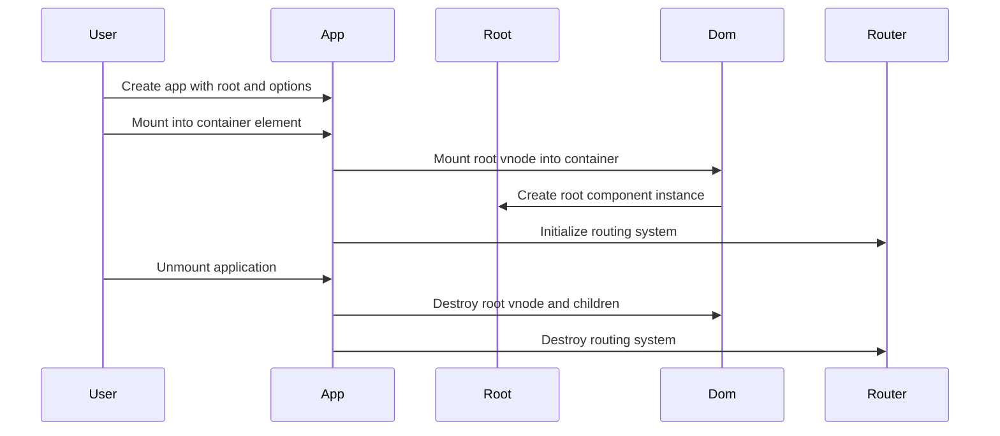

# Chapter 10: createApp / Application context

You finish your framework’s core: VNodes, components, patching, router, scheduler.

Now imagine a real user visiting your site:

- Which component do you mount first?
- Where in the DOM does it go?
- How do all components get access to the router?
- How do you shut the whole thing down cleanly?

If components are actors and the DOM is the stage, you still need a **stage manager**:

- Puts the main actor on stage (root component)
- Hands every actor the same shared tools (router, global services)
- Knows when the show starts (mount) and ends (unmount)

That is what `createApp` does.

In this chapter you’ll see:

- How `createApp` builds an **Application object** with `mount` and `unmount`
- How the **application context** is created and injected into every component
- How the router is wired in (or replaced with a no‑op)
- How this ties together all previous chapters into a runnable app

We’ll end with a small example that looks very close to how you’d actually **bootstrap** a real project.

---

## 1. The problem: lots of pieces, no single entry point

By now you have many building blocks:

- VNodes and `DOM_TYPES` from [VNode / DOM_TYPES](01_vnode_dom_types.md)
- `h`, `hFragment`, `hSlot` from [h / hString / hFragment / hSlot](02_h_hstring_hfragment_hslot.md)
- Components and lifecycle from [defineComponent / Component](03_definecomponent_component.md)
- The DOM engine from [mountDOM / destroyDOM / patchDOM](04_mountdom_destroydom_patchdom.md)
- Component events via [Dispatcher and component events (emit)](05_dispatcher_and_component_events_emit.md)
- Slots from [Slots and fillSlots](06_slots_and_fillslots.md)
- Routing from [HashRouter / RouterLink / RouterOutlet](07_hashrouter_routerlink_routeroutlet.md)
- Route matching from [RouteMatcher / validateRoute](08_routematcher_validateroute.md)
- The scheduler from [Scheduler / nextTick](09_scheduler_nexttick.md)

Each piece works, but if you write the bootstrapping code yourself, it might look like:

```js
// Pseudocode
const router = new HashRouter(routes)
const appContext = { router }

const vdom = h(AppRoot, appProps)
mountDOM(vdom, document.getElementById('app'), null, { appContext })

router.init()
```

And on teardown:

```js
destroyDOM(vdom)
router.destroy()
```

You could do that manually in every project, but then:

- Every app has to remember to wire the `appContext` correctly
- Every app has to remember to init and destroy the router
- You have no single abstraction that says “this is *the* application”

`createApp` is a thin wrapper that bundles these conventions into one place.

---

## 2. What `createApp` returns: the Application object

The public API is simple—exported from `index.js`:

```js
// index.js
export { createApp } from './app.js'
```

Definition (simplified JSDoc from `app.js`):

```js
/**
 * @typedef Application
 * @type {object}
 * @property {(parentEl: HTMLElement) => void} mount
 * @property {function} unmount
 */
```

You call:

```js
import { createApp } from './index'
import { App } from './App'

const app = createApp(App, { title: 'Hello' }, { router })
app.mount(document.getElementById('app'))

// Later, maybe:
app.unmount()
```

Analogy: `createApp` is like hiring a stage manager. The returned `app` is the manager:

- `mount(parentEl)` → raise the curtain, put the root actor on stage
- `unmount()` → clear the stage, shut down lighting, close the theater

Let’s look at how `createApp` builds that manager.

---

## 3. The `createApp` function, piece by piece

Here is `createApp` from `app.js`, broken into chunks.

### 3.1 Signature and internal state

```js
export function createApp(RootComponent, props = {}, options = {}) {
  let parentEl = null
  let isMounted = false
  let vdom = null
```

- `RootComponent` – the top‑level component class, created with `defineComponent` from [defineComponent / Component](03_definecomponent_component.md).
- `props` – initial props for that root component.
- `options` – extra configuration, currently only `router`.

Internal variables:

- `parentEl` – the actual DOM element we mount into (`<div id="app">` or similar).
- `isMounted` – boolean guard so you don’t mount twice or unmount before mounting.
- `vdom` – the root VNode for the app (created with `h`).

### 3.2 Building the application context

```js
  // The application context is injected into every component mounted in the app.
  // This gives components access to objects that are global to the application.
  const context = {
    router: options.router || new NoopRouter(),
  }
```

This is the **application context**:

- A plain object shared by all components.
- For now, it only has `router`, but you could imagine adding `store`, `i18n`, etc.

Behavior:

- If you pass `options.router`, that router is used.
- If you don’t, the framework uses a `NoopRouter` from `router.js`:

  ```js
  export class NoopRouter {
    init() {}
    destroy() {}
    navigateTo() {}
    back() {}
    forward() {}
    subscribe() {}
    unsubscribe() {}
  }
  ```

  This behaves like a dummy router: all methods exist but do nothing. Components that expect `this.appContext.router` can safely call methods without crashing, they just won’t navigate.

Analogy: the application context is a **backstage toolbox** shared by all actors. Right now, it holds a “router” tool: maybe a real one, maybe just a fake plastic toy if you didn’t configure routing.

### 3.3 Reset helper

```js
  function reset() {
    parentEl = null
    isMounted = false
    vdom = null
  }
```

Simple cleanup:

- Set all internal references back to neutral values.
- Called from `unmount` after the DOM is destroyed and the router is shut down.

### 3.4 Returning the `mount` and `unmount` methods

```js
  return {
    mount(_parentEl) {
      if (isMounted) {
        throw new Error('The application is already mounted')
      }

      parentEl = _parentEl
      vdom = h(RootComponent, props)
      mountDOM(vdom, parentEl, null, { appContext: context })

      context.router.init()

      isMounted = true
    },

    unmount() {
      if (!isMounted) {
        throw new Error('The application is not mounted')
      }

      destroyDOM(vdom)
      context.router.destroy()
      reset()
    },
  }
}
```

We’ll break each method down.

---

## 4. `mount`: starting the show

`mount(parentEl)` is how you boot the app.

```js
mount(_parentEl) {
  if (isMounted) {
    throw new Error('The application is already mounted')
  }

  parentEl = _parentEl
  vdom = h(RootComponent, props)
  mountDOM(vdom, parentEl, null, { appContext: context })

  context.router.init()

  isMounted = true
}
```

### 4.1 Guard against double mount

```js
if (isMounted) {
  throw new Error('The application is already mounted')
}
```

- Protects you from accidental multiple initializations.
- Once mounted, you must `unmount` before calling `mount` again.

### 4.2 Store the host element

```js
parentEl = _parentEl
```

- This is typically something like `document.getElementById('app')`.
- All root DOM nodes for your app go inside this element.

### 4.3 Create the root VNode

```js
vdom = h(RootComponent, props)
```

Using `h` from [h / hString / hFragment / hSlot](02_h_hstring_hfragment_hslot.md):

- `tag` is the `RootComponent` class (a function constructor).
- So `h` creates a VNode with `type: 'component'` and `props: props`.
- No explicit children here; the root component may have its own slots, but `createApp` doesn’t pass any external content.

This is your **virtual root**: a *blueprint* for the root component, not DOM yet.

### 4.4 Mount VDOM to real DOM, injecting app context

```js
mountDOM(vdom, parentEl, null, { appContext: context })
```

Now we cross into the DOM layer from [mountDOM / destroyDOM / patchDOM](04_mountdom_destroydom_patchdom.md).

Recall `mountDOM` signature:

```js
export function mountDOM(vdom, parentEl, index, hostComponent = null)
```

Here `hostComponent` is passed as `{ appContext: context }`, a small object that has:

- No component lifecycle methods,
- No state,
- Only an `appContext` field.

Why pass this instead of `null`?

Inside `mountDOM`, when it sees a component VNode, it calls `createComponentNode`:

```js
function createComponentNode(vdom, parentEl, index, hostComponent) {
  const { tag: Component, children } = vdom
  const { props, events } = extractPropsAndEvents(vdom)
  const component = new Component(props, events, hostComponent)
  component.setExternalContent(children)
  component.setAppContext(hostComponent?.appContext ?? {})

  component.mount(parentEl, index)
  vdom.component = component
  vdom.el = component.firstElement
}
```

Two important details:

- `new Component(props, events, hostComponent)`:
  - `hostComponent` becomes this instance’s `parentComponent`.
  - For the root, that parent is the `{ appContext: context }` object.
- `component.setAppContext(hostComponent?.appContext ?? {})`:
  - For the root, `hostComponent.appContext` is exactly the `context` we built in `createApp`.
  - So `this.appContext` inside the root component is that shared object.
  - For children, `hostComponent` is a real `Component` instance, and `hostComponent.appContext` is the same context, so it flows down the tree.

Analogy: you hand the **first actor** a little badge that says “I’m part of Show #1, use these tools.” That actor then gives the same badge to every child actor they hire. The badge is `appContext`, and you attach it at the root via `hostComponent`.

This is how components like `RouterOutlet` and `RouterLink` can access the router:

```js
// inside router-components.js
this.appContext.router
```

without you ever passing the router as a normal prop.

### 4.5 Initialize the router

```js
context.router.init()
```

From [HashRouter / RouterLink / RouterOutlet](07_hashrouter_routerlink_routeroutlet.md), `HashRouter.init()`:

- Ensures there is a hash in the URL (`#/` if empty).
- Starts listening to `popstate` events.
- Matches the current route and notifies subscribers.

If your `options.router` was a real `HashRouter`, this kicks routing into gear. If it was a `NoopRouter`, this is a no‑op.

Important: `mountDOM` must run before `router.init()` so that:

- Components like `RouterOutlet` exist and can subscribe in their `onMounted` hooks.
- The router’s initial route match will have somewhere to send its “route changed” event.

### 4.6 Mark app as mounted

```js
isMounted = true
```

From now on:

- A second `mount()` call throws.
- `unmount()` is allowed.

---

## 5. `unmount`: stopping the show

When you want to take everything down—maybe you’re hot‑reloading in development, or your SPA is being removed from a page—you call `unmount()`:

```js
unmount() {
  if (!isMounted) {
    throw new Error('The application is not mounted')
  }

  destroyDOM(vdom)
  context.router.destroy()
  reset()
}
```

### 5.1 Guard against unmounting before mount

```js
if (!isMounted) {
  throw new Error('The application is not mounted')
}
```

No effect if you call `unmount` on a fresh app object.

### 5.2 Destroy the DOM and components

```js
destroyDOM(vdom)
```

From [destroyDOM](04_mountdom_destroydom_patchdom.md) and `destroy-dom.js`:

- Walks the entire VNode tree starting at `vdom`.
- For each node:
  - Removes DOM nodes from the document.
  - Detaches event listeners (via `removeEventListeners`).
  - For component nodes:
    - Calls `component.unmount()`:
      - Calls `destroyDOM` on the component’s inner tree.
      - Unsubscribes dispatcher subscriptions (component events).
    - Schedules `component.onUnmounted()` through the scheduler ([Scheduler / nextTick](09_scheduler_nexttick.md)).

By the time `destroyDOM` returns, all DOM created for your app has been removed, and all component instances have been told to clean up.

### 5.3 Destroy the router

```js
context.router.destroy()
```

From `HashRouter.destroy()`:

- Removes the `popstate` event listener.
- Unsubscribes all route change handlers (including `RouterOutlet`).

From `NoopRouter.destroy()`:

- Does nothing.

Now the router no longer affects global state or listens to browser events.

### 5.4 Reset the internal app state

```js
reset()
```

Back to:

- `parentEl = null`
- `isMounted = false`
- `vdom = null`

If you wanted, you could call `mount()` again with a fresh container, perhaps with different initial `props` if you built a new `Application` via `createApp`.

---

## 6. How everything fits: app, root component, DOM, router

Let’s visualize one full cycle:

- You create the app.
- You mount the app.
- The root component mounts, children mount, router initializes.
- Later, you unmount the app, tearing everything down.

We’ll show five participants:

- `UserCode` – your main file calling `createApp`, `mount`, `unmount`
- `AppMgr` – the `Application` object returned by `createApp`
- `RootComp` – the root component instance
- `DomEngine` – `mountDOM` and `destroyDOM`
- `Router` – the `HashRouter` or `NoopRouter`



Tie to previous chapters:

- `Root` is a `Component` class instance from [defineComponent / Component](03_definecomponent_component.md).
- `Dom` is `mountDOM` / `destroyDOM` / `patchDOM` from [mountDOM / destroyDOM / patchDOM](04_mountdom_destroydom_patchdom.md).
- `Router` is `HashRouter` or `NoopRouter` from [HashRouter / RouterLink / RouterOutlet](07_hashrouter_routerlink_routeroutlet.md).
- The actors inside `Dom` and `Root` use dispatchers, slots, route matchers, and the scheduler as described in [Dispatcher and component events (emit)](05_dispatcher_and_component_events_emit.md), [Slots and fillSlots](06_slots_and_fillslots.md), [RouteMatcher / validateRoute](08_routematcher_validateroute.md), and [Scheduler / nextTick](09_scheduler_nexttick.md).

---

## 7. A complete example: wiring everything together

Let’s write the kind of code you’d have in a small app’s `main.js`.

### 7.1 Define some routes

```js
// routes.js
import { Home } from './Home'
import { User } from './User'
import { NotFound } from './NotFound'

export const routes = [
  { path: '/', component: Home },
  { path: '/users/:userId', component: User },
  { path: '*', component: NotFound },
]
```

`Route` structure and matching come from [RouteMatcher / validateRoute](08_routematcher_validateroute.md).

### 7.2 Define the root component

```js
// App.js
import { defineComponent } from './component'
import { h } from './h'
import { RouterLink, RouterOutlet } from './router-components'

export const App = defineComponent({
  render() {
    return h('div', null, [
      h('h1', null, ['My App']),
      h('nav', null, [
        h(RouterLink, { to: '/' }, ['Home']),
        h(RouterLink, { to: '/users/42' }, ['User 42']),
      ]),
      h(RouterOutlet),
    ])
  },
})
```

This uses:

- Components from [defineComponent / Component](03_definecomponent_component.md)
- `h`, `RouterLink`, `RouterOutlet` from [h / hString / hFragment / hSlot](02_h_hstring_hfragment_hslot.md) and [HashRouter / RouterLink / RouterOutlet](07_hashrouter_routerlink_routeroutlet.md)

### 7.3 Create the router and the app

```js
// main.js
import { createApp, HashRouter } from './index'
import { App } from './App'
import { routes } from './routes'

const router = new HashRouter(routes)

const app = createApp(App, { title: 'Hello world' }, { router })
app.mount(document.getElementById('app'))

// Later, if needed:
// app.unmount()
```

What happens:

- `new HashRouter(routes)`:
  - Validates each route via `validateRoute`.
  - Creates a RouteMatcher for each via `makeRouteMatcher`.
- `createApp(App, props, { router })`:
  - Stores `RootComponent = App`, `props = { title: 'Hello world' }`, `options.router = router`.
  - Builds `context = { router }`.
- `app.mount(container)`:
  - Creates the root VNode: `h(App, { title: 'Hello world' })`.
  - Calls `mountDOM` with `hostComponent = { appContext: context }`.
    - This ensures `App` and every child component see `this.appContext.router`.
  - Calls `router.init()`, which:
    - Ensures a hash exists.
    - Listens to `popstate`.
    - Matches the initial route and notifies `RouterOutlet`.

From this point on:

- DOM updates are handled by `mountDOM` and `patchDOM`.
- Component state updates happen through `updateState`.
- Component events use the `Dispatcher`.
- Slots are filled by `fillSlots`.
- Routing is kept in sync with the hash by `HashRouter`.
- Lifecycle hooks run through the scheduler’s job queue.
- And the Application object is your single control handle for the whole tree.

---

## 8. Recap

`createApp` is the final bit of scaffolding that turns all the framework pieces into a **real application**:

- It takes:
  - A root component class (`RootComponent`)
  - Initial props for that component
  - An options object with global services (currently `router`)
- It builds an **application context**:
  - A shared object (`context`) injected into every component as `this.appContext`
  - Starts with `router`, using `HashRouter` or `NoopRouter`
- It returns an **Application**:
  - `mount(parentEl)`:
    - Creates a root VNode with `h(RootComponent, props)`
    - Calls `mountDOM` with a host object carrying `appContext`
    - Calls `router.init()` to start routing
  - `unmount()`:
    - Calls `destroyDOM` to tear down all components, DOM, and handlers
    - Calls `router.destroy()` to stop listening to browser navigation
    - Clears internal references so the Application can’t be misused

From the actor analogy: components are actors, the DOM is the stage, the router is the script, the scheduler coordinates cues—and `createApp` is the stage manager that puts it all together.

Now that you’ve seen how this tiny framework hangs together from VNodes to full apps, the next natural question is: how would you **extend** or **adapt** this architecture for your own ideas—new global services, different routers, or integration with other tools? That exploration is where your own experiments begin.