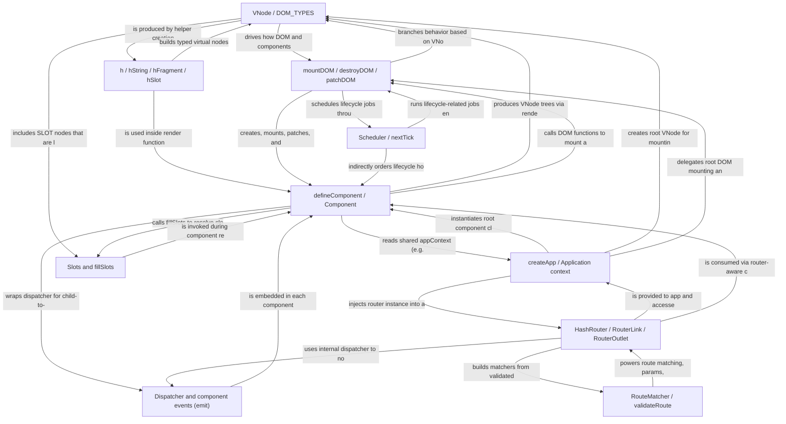

# src

_Lens: beginner-tutorial_

This project is a small component-based frontend framework with its own virtual DOM, diffing algorithm, and router. You build apps by defining components, returning virtual DOM trees from their render functions, and letting the framework mount, update, and unmount them efficiently in the browser.

## Architecture

## Chapters

- [VNode / DOM_TYPES](01_vnode_dom_types.md)
- [h / hString / hFragment / hSlot](02_h_hstring_hfragment_hslot.md)
- [defineComponent / Component](03_definecomponent_component.md)
- [mountDOM / destroyDOM / patchDOM](04_mountdom_destroydom_patchdom.md)
- [Dispatcher and component events (emit)](05_dispatcher_and_component_events_emit.md)
- [Slots and fillSlots](06_slots_and_fillslots.md)
- [HashRouter / RouterLink / RouterOutlet](07_hashrouter_routerlink_routeroutlet.md)
- [RouteMatcher / validateRoute](08_routematcher_validateroute.md)
- [Scheduler / nextTick](09_scheduler_nexttick.md)
- [createApp / Application context](10_createapp_application_context.md)